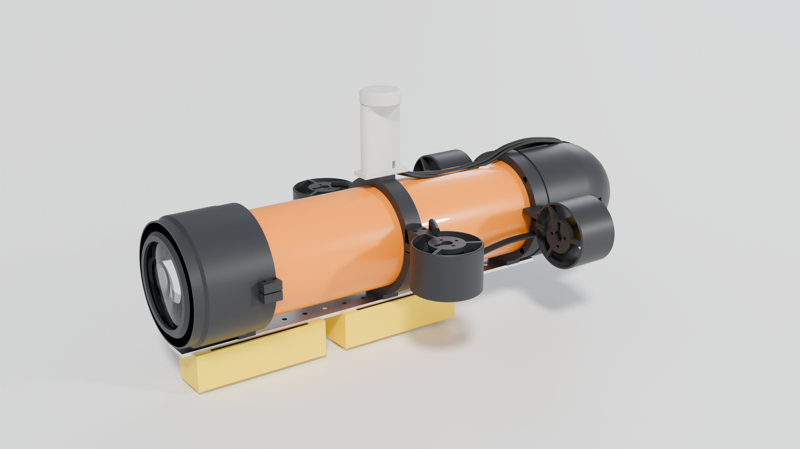
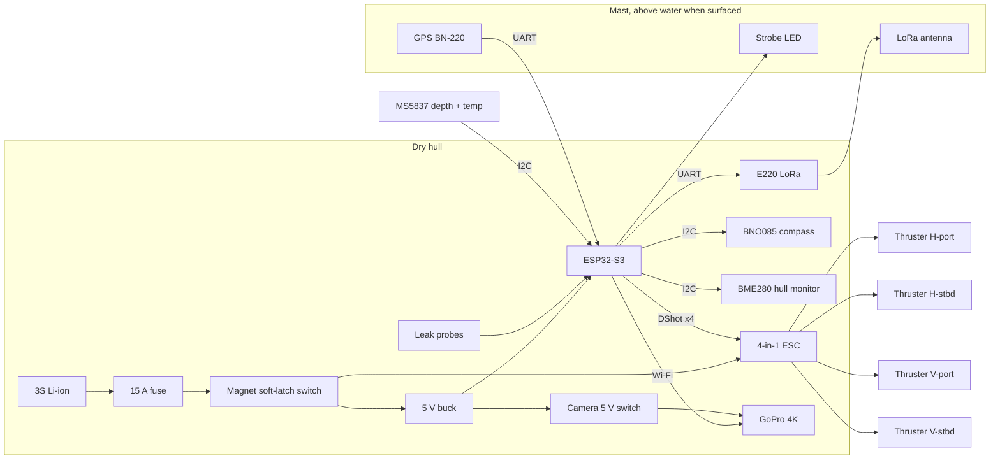
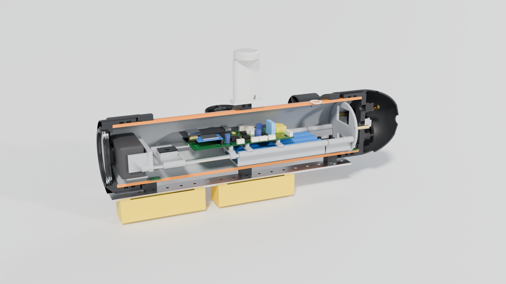

# Minnow: a £300 autonomous mini-submarine with a 4K camera

Minnow is a small torpedo-style AUV (autonomous underwater vehicle) for lakes and swimming pools.
It dives, holds a depth and a heading on its own, records 4K video through a front window, and
comes back up to check its position by GPS between dives. It is designed to be built at home
with a 3D printer, a soldering iron and about **£260–330** of parts.



| | |
|---|---|
| Size | 467 mm long, 248 mm wide over the thrusters, 221 mm tall (mast to ballast pods) |
| Mass | 3.35 kg ready to dive (including 0.58 kg of lead shot) |
| Pressure hull | 90 mm PVC-U pressure pipe, two 3D-printed end caps with double O-rings |
| Design depth | 10 m (calculated hull collapse is above 70 m; window safety factor about 4) |
| Thrusters | 4 x A2212 brushless motors in printed ducts: 2 push forward/turn, 2 push up/down |
| Brain | ESP32-S3 on a custom carrier PCB (this repo), 4-in-1 ESC driven with DShot |
| Sensors | GPS (in the mast), BNO085 compass/IMU, MS5837 depth + water temperature, hull pressure/humidity, 2 leak probes, battery voltage and motor current |
| Camera | GoPro HERO5/6/7 Black inside the hull behind an 8 mm acrylic window, powered and started by the sub |
| Radio | LoRa 868 MHz telemetry at the surface (km range), Wi-Fi on the bench |
| Power | 3S Li-ion 18650 pack(s), 15 A fuse, magnet on/off switch, roughly 2 h (one pack) to 4 h (two packs) |
| Behaviour | Surface -> GPS fix -> point at the next waypoint -> dive -> hold depth and heading -> surface -> correct -> repeat |

## What is in this folder

| Folder | What it is |
|---|---|
| [`docs/`](docs) | The plan: how every part works, how to build it, how to test it |
| [`cad/`](cad) | Parametric Blender model (`build_sub.py`), 26 print-ready STLs, renders, drawings, mass/trim report |
| [`pcb/`](pcb) | KiCad project for the rev 1 main board: schematic, routed 2-layer PCB, Gerbers ready to order, PCB BOM (you solder it) |
| [`pcb-core/`](pcb-core) | **Minnow Core**: the all-in-one board that JLCPCB fully assembles (ESP32, USB-C, compass, hull sensor, LoRa, power, camera port). Order two: sub + shore radio |
| [`bom/`](bom) | The complete parts list for every part of the sub, with prices and a budget summary |

### The documents, in the order you will need them

1. [Mechanical design](docs/01-mechanical.md): hull, seals, window, frame, thrusters, ballast, printing.
2. [Electronics](docs/02-electronics.md): power system, the main board, wiring, pin map.
3. [The 4K camera](docs/03-camera.md): which camera, the optics, and how the sub controls it.
4. [Software and autonomy](docs/04-software.md): firmware structure, navigation, failsafes, shore station.
5. [Build and test plan](docs/05-build-and-test.md): the order to build things in, every test, checklists, safety.

## How it works



* **Navigation underwater has no GPS** (radio does not travel through water). Minnow steers by compass
  and time while submerged, then surfaces to get a GPS fix and corrects for any drift, the way ocean
  gliders do. Expect a few metres of error per minute underwater, so the missions use short legs.
* **It floats when anything goes wrong.** The sub is trimmed 45 g positive. The vertical thrusters hold
  it down; if power, software or a sensor fails, it rises to the surface by itself and flashes its strobe.
* **The camera sits inside the dry hull** looking through the window in the front cap. The sub powers it
  over USB (so it can record for hours) and starts and stops recording over Wi-Fi.



## Budget

The full itemised list is [`bom/bom.csv`](bom/bom.csv); the summary is [`bom/bom_summary.md`](bom/bom_summary.md).
**Ready to order? Use the [shopping list](bom/shopping_list.md)**: every part, grouped by shop, with links.

| | Cost |
|---|---:|
| Phase 1: pool-ready autonomous sub with the 4K camera | £306 |
| Phase 2: LoRa telemetry for lake missions | £24 |
| **Everything, bought from scratch** | **£330** |
| Of which most makers already own (filament, screws, glue, wire, SD card...) | £72 |
| **Everything, if you have the usual workshop supplies** | **£258** |

**Rather not solder?** The [Minnow Core board](pcb-core/README.md) arrives fully assembled from JLCPCB and replaces
the ESP32 DevKit, compass, hull sensor, both radios, USB adapter, reed switch, camera socket and all 38 lines of
board parts. Two finished boards cost about £190–205, roughly £110–125 more than the parts they replace.

Prices are rough UK prices (late 2026). The biggest single items are the used GoPro (£50), the ESP32 and
sensors, and the 4-in-1 ESC. The [budget summary](bom/bom_summary.md) lists ways to save more.

## Build phases at a glance

| Phase | What you do | Done when |
|---|---|---|
| 0. Order and print | Order parts and the PCB (2–3 weeks shipping); print the O-ring fit test first, then all parts | Fit test seals on your pipe |
| 1. Dry hull | Cut the pipe, fit the caps, window and glands | Holds a vacuum for 15 minutes, then survives a bath for an hour with tissue paper inside |
| 2. Electronics on the bench | Solder the board, flash the firmware, test every sensor and output | All sensors read sensibly; thrusters spin both ways |
| 3. Pool | Trim with lead shot, tune depth and heading control | Holds 1 m depth within ±5 cm and a straight heading |
| 4. Lake, on a line | Tethered to a fishing line and float | Completes a 3-waypoint mission and comes back up every time |
| 5. Lake, untethered | Full autonomous missions with 4K video | Brings back footage and a GPS track |

## Regenerating the design files

Everything here is generated from code, so you can change a number and rebuild:

```bash
# CAD: model, STLs, renders and the trim report (needs Blender 4.2+ or: pip install bpy)
cd submarine/cad && python3.11 build_sub.py --stl --blend --render && python3.11 make_drawings.py
```

```bash
# PCB: schematic, placement, autorouting (Freerouting), DRC and fabrication files (needs KiCad 7+)
cd submarine/pcb && FREEROUTING_JAR=/path/to/freerouting.jar python3 generate_board.py all
```

```bash
# Parts list, budget and shopping list
cd submarine/bom && python3 make_bom.py && python3 make_shopping_list.py
```

## Safety, in short

Lithium batteries are charged outside the hull, never inside it. The hull is leak-tested with a vacuum before every
dive. Every mission has a maximum depth, maximum dive time and battery limit that send the sub to the surface.
Ask the landowner or navigation authority before using any lake, canal or river, and keep away from swimmers
and boats. Details are in the [build and test plan](docs/05-build-and-test.md#57-safety-and-the-law).
