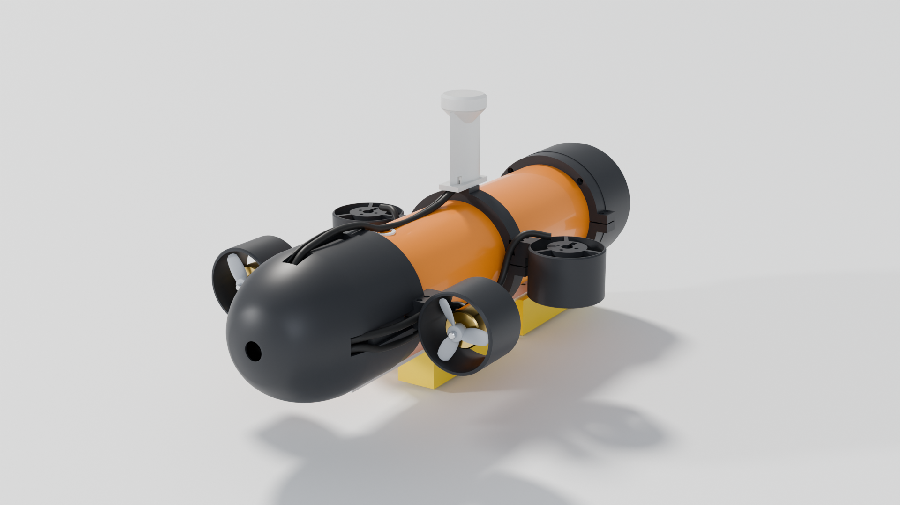

# CAD: parametric Blender model

`build_sub.py` builds the whole submarine in Blender from one block of parameters, then exports the
printable parts, the renders and a mass / buoyancy / trim report. Nothing in this folder is drawn by hand.



## Run it

In the Blender UI (4.2 LTS or newer): open `build_sub.py` in the Text Editor and press **Run Script**.
The model appears in collections: Hull, Frame, Fairings, Thrusters, Internals, Cables.

Headless, with Blender installed:

```bash
blender -b -P build_sub.py -- --stl --blend --render
```

Or with the `bpy` Python module (`pip install bpy` on Python 3.11 gives Blender 4.5 LTS):

```bash
python3.11 build_sub.py --stl --blend --render
```

```bash
python3.11 make_drawings.py
```

| Flag | Output |
|---|---|
| (none) | builds the model, writes `trim_report.md`, `design_data.json` |
| `--stl` | `stl/*.stl` (print-ready orientation) and `print_list.json` |
| `--blend` | `minnow_auv.blend` |
| `--render` | `renders/*.png` (Cycles, CPU, about 20 minutes) |
| `--quick` | low-quality renders for testing |
| `--core` | show the [Minnow Core](../pcb-core/README.md) all-in-one board instead of the rev 1 board: no separate IMU bracket or reed switch, magnet mark on the hull's port side (use with `--out` to keep the default outputs) |

`make_drawings.py` then writes `drawings/general_arrangement.png/.pdf`, `drawings/end_cap_sections.png`
and the window cut files `drawings/window_80x8.svg/.dxf`.

If `../pcb/placement.json` and `../pcb/output/board_top.png` (or the `../pcb-core/` ones with `--core`) exist (the KiCad generator writes them), the main
board in the model is the real board: its texture comes from the Gerber layers and the parts from the placement.

## Measure these before you print

| Parameter | Default | Why it matters |
|---|---|---|
| `pipe_od` | 90.0 | The O-rings seal on it. Measure in several places |
| `pipe_wall` | 4.3 | PN10 4.3 mm, PN16 6.7 mm |
| `pipe_len` | 380 | Cut length; the internal sled is built to match |
| `oring_cs`, `oring_squeeze`, `cap_bore_clear` | 3.53, 0.20, 0.20 | Change these if the fit test is too tight or loose |
| `window_d`, `window_t` | 80, 8 | Your acrylic disc |
| `cam_w`, `cam_h`, `cam_d`, `cam_lens_y`, `cam_lens_z`, `cam_bump` | GoPro HERO5–7 | Your camera's body and lens position |
| `batt_*` | 65 x 56 x 19, 2 packs | Your battery packs |
| `reserve_buoyancy_g` | 45 | How strongly it floats when off |

After a change, run the script again: the parts, renders and the trim report (lead needed and where) all update.

## Outputs

* `stl/`: 25 part files plus the O-ring fit test (some parts are printed twice). See the print table in [`../docs/01-mechanical.md`](../docs/01-mechanical.md#111-print-list).
* `renders/`: hero, rear, cutaway, exploded, seal sections, internal sled, thruster close-up, orthographic views.
* `drawings/`: general arrangement with dimensions, end-cap sections, window cut file.
* `trim_report.md`: every part's mass, displacement and position, plus the ballast solution and stability.
* `design_data.json`: all parameters and derived dimensions as data (used by `make_drawings.py`).

## How the model is built

Parts are solids of revolution (caps, pipe, ducts, nose ring, tail cone, O-rings), extrusions (clamps,
mast) and generated surfaces (the propeller blades, lofted from cambered sections at 14 radii along a 42 mm pitch
helix). They are combined with Blender's exact boolean solver. The trim solver adds up the mass and displaced
volume of every part, works out how much lead is needed for 45 g of reserve buoyancy, and picks the two ballast-pod
positions on the keel bar's 20 mm hole grid that put the centre of gravity directly under the centre of buoyancy.
