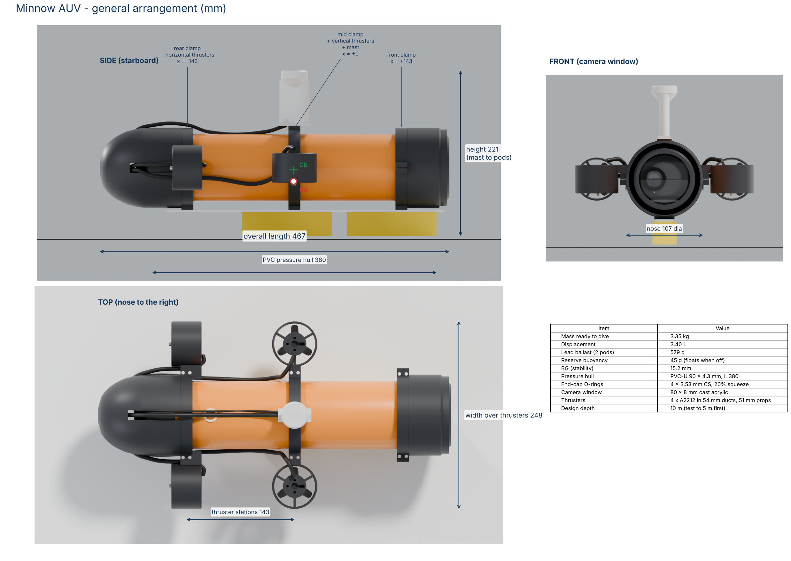
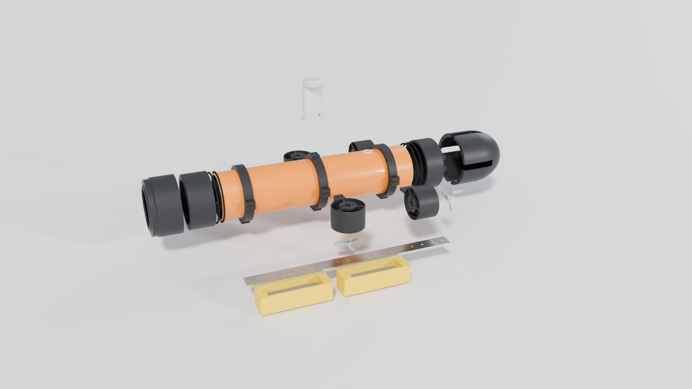
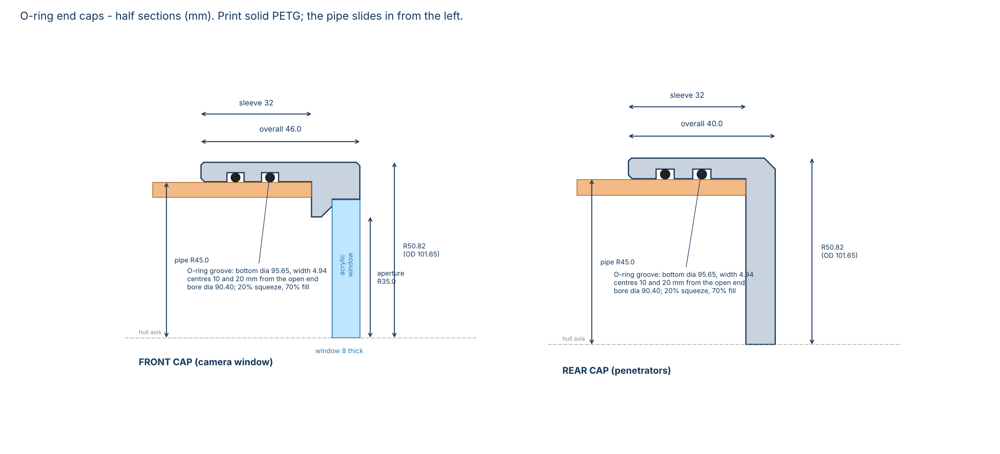
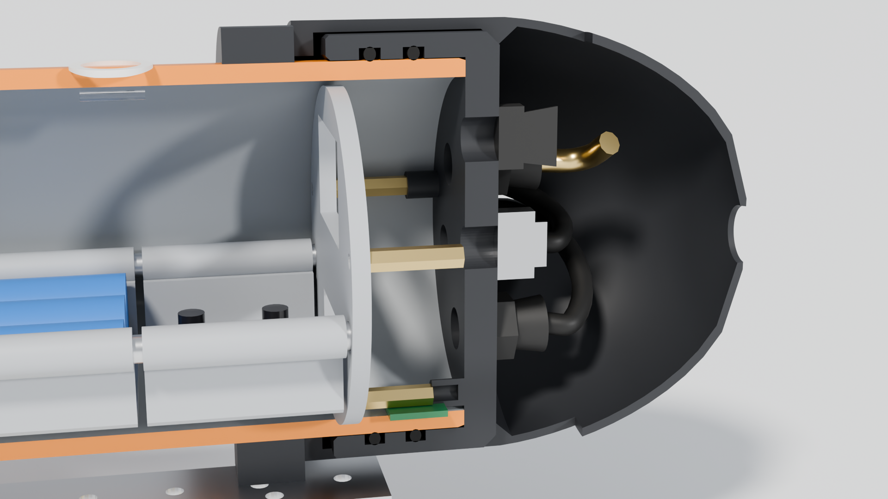
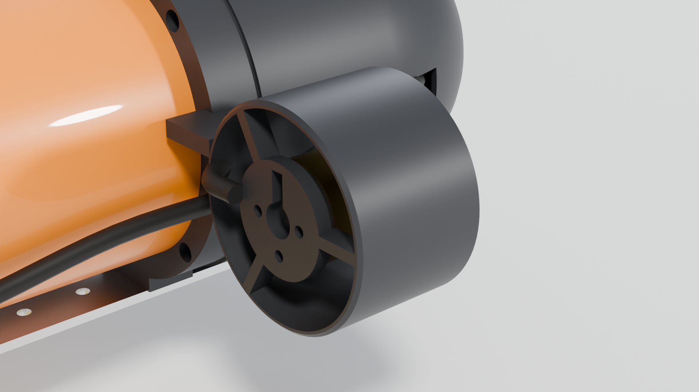
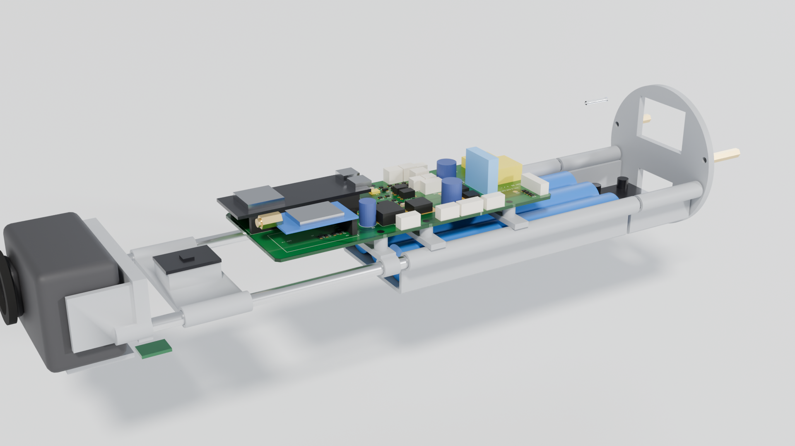

# 1. Mechanical design

Everything here comes from the parametric model [`cad/build_sub.py`](../cad/build_sub.py). Change a number in
its `P = dict(...)` block (for example the pipe wall you measured) and rebuild to get new STLs, renders and a
new trim report. Units are millimetres; the vehicle's axes are +X forward, +Y to port (left), +Z up.

## 1.1 Layout

From the nose backwards:

* **Nose ring** (printed) holds the acrylic window and the front end cap on.
* **Front end cap** (printed, two O-rings) with the **8 mm acrylic window**. The GoPro sits right behind it.
* **Pressure hull**: 380 mm of 90 mm PVC-U pressure pipe. Everything that must stay dry is inside.
* **Three clamp rings** around the hull carry everything outside it:
  * the *front* clamp holds the nose ring;
  * the *mid* clamp carries the two **vertical thrusters** and the **mast**, right above the centre of gravity, so pushing up or down does not tip the nose;
  * the *rear* clamp carries the two **horizontal thrusters** (forward, reverse and steering) and the tail cone.
* **Keel bar** (aluminium) under all three clamps, with two **ballast pods** of lead shot hanging under it.
* **Rear end cap** (printed, two O-rings) with seven cable glands and the depth sensor.
* **Tail cone** (printed) streamlines the back and also holds the rear cap on.

## 1.2 Pressure hull

| | |
|---|---|
| Material | PVC-U pressure pipe, metric 90 mm OD, PN10 (4.3 mm wall). PN16 (6.7 mm) also works: set `pipe_wall=6.7` |
| Length | 380 mm, ends cut square |
| Why this pipe | Its outside diameter is held to a tight tolerance (90.0 to 90.3 mm), so the O-rings seal on the outside of the pipe. The inside diameter varies much more. |
| Collapse pressure | About 7.7 bar for a long tube of this size (thin-shell buckling, E = 3 GPa), more with the caps stiffening the ends. That is over 70 m; the design depth is 10 m. |

Preparation:

1. Cut 380 mm with a fine saw in a mitre box (or a pipe cutter) so the ends are square.
2. Chamfer the outside edge of both ends about 1.5 mm at 15 degrees with a file, then smooth with fine
   sandpaper. **This chamfer stops the pipe end cutting the O-rings** as it slides into the cap.
3. Optional: paint the pipe high-visibility orange (plastic primer first). **Mask the last 35 mm of each
   end**, because the O-rings must seal on bare, smooth pipe.
4. Do not drill the pipe anywhere. Nothing goes through it.

## 1.3 End caps and O-ring seals

Both caps are sleeves that slide **over** the pipe. Each has two O-rings in internal grooves that squeeze
onto the pipe's outside surface (a "rod seal"). The pipe end stops against a shoulder inside the cap.

| Seal number | Value |
|---|---|
| O-ring | AS568-238 (88.49 x 3.53 mm) or metric 89 x 3.5 mm, NBR 70 |
| Cap bore | 90.40 mm (0.2 mm radial clearance) |
| Groove bottom diameter | 95.65 mm |
| Groove width | 4.94 mm |
| Groove centres | 10 and 20 mm from the open end of the cap |
| Squeeze / gland fill | 20 % / 70 % (normal values for a static seal) |
| Cap outside diameter | 101.65 mm |

**Print the fit test first.** `cad/stl/00_Oring_fit_test.stl` is a 16 mm slice of a cap with one groove.
Put a greased O-ring in it and push it onto your pipe. It should go on with firm hand pressure and not wobble.
If it is too loose or too tight, change `oring_squeeze` or `cap_bore_clear` in `build_sub.py`, rebuild, and
print the test again. Ten minutes here saves a flooded camera later.

Printing the caps (they are the pressure boundary, so be careful):

* PETG, **100 % infill**, 0.12–0.16 mm layers, 5+ perimeters, slightly hot (about 245 °C) for good layer
  bonding, slow outer walls. The front cap prints window-face down, the rear cap rear-face down. Neither
  needs supports: the overhangs are 45 degree chamfers.
* After printing, brush a thin coat of laminating epoxy over the **outside** surfaces to seal any pores.
  Keep epoxy **out of the O-ring grooves and the bore**.
* Grease the O-rings lightly with silicone grease before fitting. Never use petroleum grease on NBR.

How the caps stay on: the **nose ring** is screwed to the front clamp and its lip presses on the front cap;
the **tail cone** is screwed to the rear clamp and seats on a 45 degree chamfer on the rear cap. Before every
dive you also pull a slight vacuum inside the hull (see the test plan), which pulls both caps on and proves the seal.

## 1.4 Camera window

* 80 mm diameter x 8 mm **cast** acrylic (cast is clearer and stronger than extruded). Order it laser cut
  using [`cad/drawings/window_80x8.svg`](../cad/drawings/window_80x8.svg) or the `.dxf`.
* It sits in a recess in the front face of the front cap, on a 2 mm wide seat, bedded in clear silicone
  or Sikaflex. Water pressure pushes it *into* its seat, so the deeper it goes the tighter it seals.
* Clear aperture 70 mm. The camera lens sits about 2 mm behind the window, so the view is not clipped.
* Stress at 10 m depth: about 2.4 MPa (simply-supported plate over a 70 mm span). Cast acrylic's tensile
  strength is about 70 MPa, so the margin is large.
* Clean it with soapy water and a soft cloth only; alcohol and solvents craze acrylic.

## 1.5 Rear cap penetrators

All the cables come out through the rear cap. The seven glands sit on a 52 mm circle; the depth sensor is in the middle.
Angles are measured from the top, turning towards port, looking at the cap from behind.

| Position | Angle | What goes through it | Fitting |
|---|---|---|---|
| 1 | 0° (top) | Mast cable: GPS (4 wires) + strobe (2 wires), 6-core | M12 gland |
| 2 | 51° | LoRa antenna coax (RG174/RG178, built up with heat-shrink to 3 mm) | M12 gland |
| 3 | 103° | Thruster H-port, 3-core 0.5 mm² | M12 gland |
| 4 | 154° | Thruster V-port | M12 gland |
| 5 | 206° | Thruster V-stbd | M12 gland |
| 6 | 257° | Thruster H-stbd | M12 gland |
| 7 | 309° | Vent / vacuum-test tube (6 mm silicone tube) | M12 gland |
| centre | | MS5837 depth and water-temperature sensor, M10 body, O-ring outside, nut inside | 10.3 mm hole |

Fitting the glands: the printed holes are 10.5 mm, the tap-drill size for M12 x 1.5. Tap them with an
M12 x 1.5 hand tap, then screw each gland in with a smear of silicone on the thread and its own washer
against the flat outer face. Pass the cable through, tighten the dome nut, and for extra security run a
little epoxy into the back of the gland once everything works. Three bosses on the inside face of the
rear cap (M3 heat-set inserts) carry the internal sled. They are blind holes and do not go through the cap.

## 1.6 Frame, fairings and fasteners

| Part | Material | Fixing |
|---|---|---|
| Clamp rings (front, mid, rear) | PETG, solid, printed on their side | Split in two; the M4 bolts through the side ears pinch them onto the hull and also hold the thrusters |
| Keel bar | Aluminium flat 25 x 3 mm, 370 mm long, 4.5 mm holes every 20 mm | 6 x M4 x 12 countersunk into M4 inserts under the clamps |
| Ballast pods (2) | PETG | Open side up against the keel bar; 2 x M4 x 12 each into M4 inserts. Pod centres sit 10 mm off the hole grid so both bolts land on holes |
| Nose ring | PETG, solid | 4 x M3 x 20 through the front clamp into inserts in the nose ring flange |
| Tail cone | PETG, 1.8 mm wall | 4 x M3 x 20 through the rear clamp into its flange; four open slots let it slide off over the cables |
| Mast | Clear/natural PETG, hollow, potted | 2 x M3 into the mid-clamp top pad |

Fastener and insert count: 12 x M4 x 30 with nyloc nuts and washers, 10 x M4 x 12 countersunk, 8 x M3 x 20,
about 30 x M3 x 6–8, 3 x M3 x 20 brass standoffs, 13 x M3 and 10 x M4 brass heat-set inserts. Use A2 stainless
throughout: it doesn't rust and is barely magnetic, which matters for the compass.

## 1.7 Thrusters

* **Motor:** A2212 1000KV outrunner. Brushless motors run fine fully flooded in fresh water. Rinse them in
  fresh water after every session and spray them with a corrosion inhibitor. The duct's motor plate has both
  the 16 mm and 19 mm M3 hole patterns and a slot for the wires.
* **Duct:** 54 mm inside, 40 mm long, printed solid. The mounting tab sits on top of the clamp ear and is
  bolted through it. The tab is joined to the duct's mounting end so the part prints without supports.
* **Propellers:** 51 mm, 3 blades, 42 mm pitch, generated by the script. Print two right-hand
  (`Prop_H_port_CW`) and two left-hand (`Prop_V_port_CCW`) so each pair cancels the other's torque. Print
  hub-down at 0.12 mm with tree supports, or in resin if you have it. The hub takes the motor's M5 prop adapter.
* **Placement:** horizontal pair at the rear clamp, 94 mm either side of the centreline; vertical pair at
  the mid clamp, right above the centre of gravity.
* **Wiring:** 3-core 0.5 mm² cable from each motor to the rear cap. Solder the splice at the motor, cover
  each joint in adhesive-lined heat-shrink, then the whole splice in a bigger piece. Fix cables to the hull
  with small zip ties so they cannot reach a propeller.
* **Thrust (estimate):** about 3–5 N per thruster at moderate power. Cruise speed about 0.5–0.8 m/s.

## 1.8 Internal sled

The whole inside slides out of the back of the hull as one unit, still attached to the rear cap:

| Station (x, mm) | Item |
|---|---|
| -190 to -182 | Rear cap inner face, gland nuts and cables, three M3 bosses |
| -162 | Sled rear plate on 3 x 20 mm standoffs, clamps two 6 mm aluminium rods |
| -157 to -115 | ESC tray with the 4-in-1 ESC (short motor leads to the glands) |
| -113 to 25 | Battery tray: two 3S1P packs side by side lengthways, Velcro straps |
| -62 to 88 | Main PCB on two brackets resting on the battery tray, plus one front post on the rods |
| 103 to 133 | IMU bracket: BNO085 flat and square to the hull axis, well away from motors and battery cables |
| 147 to 189 | Camera cradle with the GoPro, 3 mm foam behind it, lens 2 mm from the window |

Everything inside is clipped to stay at least 0.8 mm from the pipe wall, so the sled slides in without catching.

## 1.9 Mast

The mast is printed hollow in clear or natural PETG with 2 mm walls and no infill. Inside it, from the top:
the GPS module (antenna facing up), the strobe LED, and the 868 MHz antenna running down the fin. Feed the
cables in through the 8 mm hole in the base, test everything, then fill the mast with clear epoxy, pouring
slowly so no air is trapped. The GPS needs about 30 seconds of open sky for each fix, which is why the mast
holds it about 75 mm above the hull when the sub floats.

## 1.10 Ballast and trim

The trim numbers come from [`cad/trim_report.md`](../cad/trim_report.md), which the script calculates from
the real geometry of every printed part and the catalogue mass of every bought part:

| | |
|---|---|
| Sealed hull displacement | 2.71 L |
| Mass without ballast | 2.63 kg |
| Lead ballast needed | about 580 g: about 290 g in the front pod (centre x = +130 mm), about 290 g in the rear pod (x = -10 mm) |
| Reserve buoyancy | +45 g (it floats when switched off) |
| Centre of gravity below the centre of buoyancy (BG) | 15 mm, so roll and pitch are naturally stable and the camera stays level |

Real parts never weigh exactly what the catalogue says, so you trim in the pool:

1. Seal the hull with everything inside, fit all external parts, and put the calculated lead in the pods.
2. In the pool it should float level with the mast and the top 3–5 mm of the hull above water.
3. Add or remove lead shot in small amounts until a **45 g weight** (for example, a bag of coins) hung under
   the middle makes it hang just below the surface. Then remove the weight. That is the 45 g reserve.
4. If the nose sits low, move shot from the front pod to the rear pod, or move a pod one hole (20 mm) back
   on the keel bar, and the reverse if the tail sits low.
5. Write down the final shot masses. Re-check whenever you change batteries or add equipment.

## 1.11 Print list

All STLs are in [`cad/stl/`](../cad/stl), already oriented for printing. Total about 1.0 kg of PETG.
Printing the caps, clamps, ducts and fairings solid matters: water slowly gets into infill gaps and changes the trim.

| File | Qty | Grams each | Size (mm) | Notes |
|---|---:|---:|---|---|
| `00_Oring_fit_test.stl` | 1 | 30 | 102 x 102 x 16 | **Print first.** One groove; check the O-ring fit on your pipe |
| `FrontCap.stl` | 1 | 121 | 102 x 102 x 46 | Pressure part. 100 % infill, 0.12–0.16 mm layers, window face down, epoxy-coat outside |
| `RearCap.stl` | 1 | 134 | 102 x 102 x 40 | Pressure part. As above; tap the 7 ring holes M12 x 1.5 |
| `NoseRing.stl` | 1 | 70 | 107 x 107 x 56 | Lip down; M3 inserts in the flange |
| `TailCone.stl` | 1 | 110 | 107 x 107 x 109 | Flange down; M3 inserts in the flange |
| `Clamp_front_upper/lower.stl` | 1 each | 27 / 28 | 124 x 56 x 16 | On their side, solid |
| `Clamp_mid_upper/lower.stl` | 1 each | 28 / 29 | 124 x 56 x 16 | On their side, solid; mast pad on the upper half |
| `Clamp_rear_upper/lower.stl` | 1 each | 27 / 28 | 124 x 56 x 16 | On their side, solid |
| `Duct_H_port.stl`, `Duct_H_stbd.stl` | 1 each | 33 | 77 x 60 x 40 | Mirror images; motor end down, solid |
| `Duct_V_port.stl` | 2 | 34 | 77 x 60 x 40 | Same part for both sides (turn it round) |
| `Prop_H_port_CW.stl` | 2 | 2 | 46 x 41 x 8 | Right-hand propeller |
| `Prop_V_port_CCW.stl` | 2 | 2 | 41 x 46 x 8 | Left-hand propeller |
| `Mast.stl` | 1 | 49 | 44 x 36 x 74 | Clear PETG, hollow, potted afterwards |
| `BallastPod_front.stl` | 2 | 67 | 120 x 34 x 32 | Open side up |
| `Sled_rear_plate.stl` | 1 | 9 | 78 x 78 x 4 | Any infill |
| `Sled_esc_tray.stl` | 1 | 6 | 42 x 75 x 24 | 30.5 mm ESC hole pattern |
| `Sled_battery_tray.stl` | 1 | 21 | 138 x 75 x 24 | |
| `Sled_pcb_bracket_1/2.stl`, `Sled_pcb_front_post.stl` | 1 each | 1 | 8 x 75 x 8–18 | Carry the main board |
| `Sled_imu_bracket.stl` | 1 | 7 | 30 x 75 x 14 | |
| `Sled_camera_cradle.stl` | 1 | 12 | 34 x 75 x 39 | Trim the side finger if it blocks your camera's door |

## 1.12 Mechanical assembly order

1. Print the fit test, check the O-ring fit, adjust if needed.
2. Print and epoxy-coat the caps. Fit the window into the front cap with sealant and let it cure for 24 hours.
3. Tap the rear cap, fit the glands, the depth sensor and the vent tube. Melt the M3 inserts into the bosses.
4. Melt all the heat-set inserts into the clamps, pods, nose ring, tail cone and mast pad.
5. Cut and chamfer the pipe. Fit the front cap (greased O-rings), then the front clamp, then the nose ring.
6. Fit the mid and rear clamps loosely, then the keel bar, then tighten the clamps with the keel bar straight.
7. Build the sled outside the hull, then slide it in and fit the rear cap and the tail cone.
8. Bolt on the thrusters and the mast, route and tie the cables.
9. Vacuum test (see the test plan) before anything goes near water.
