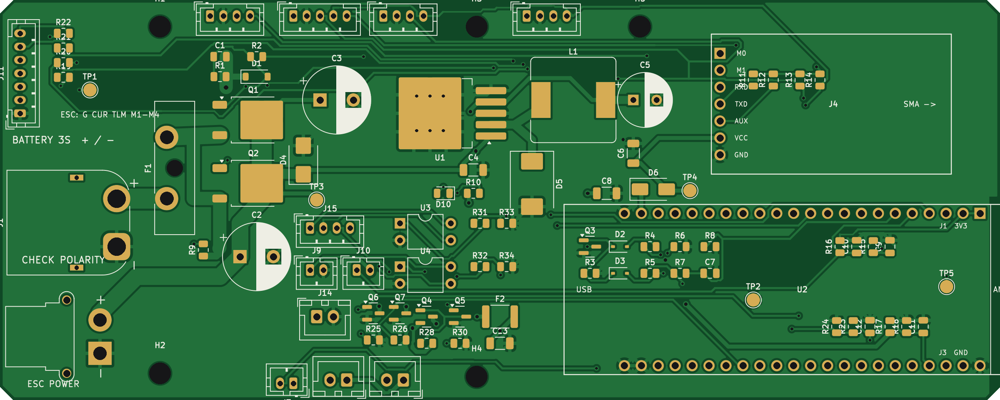
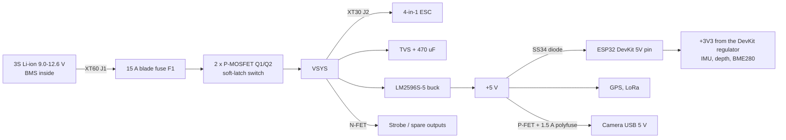
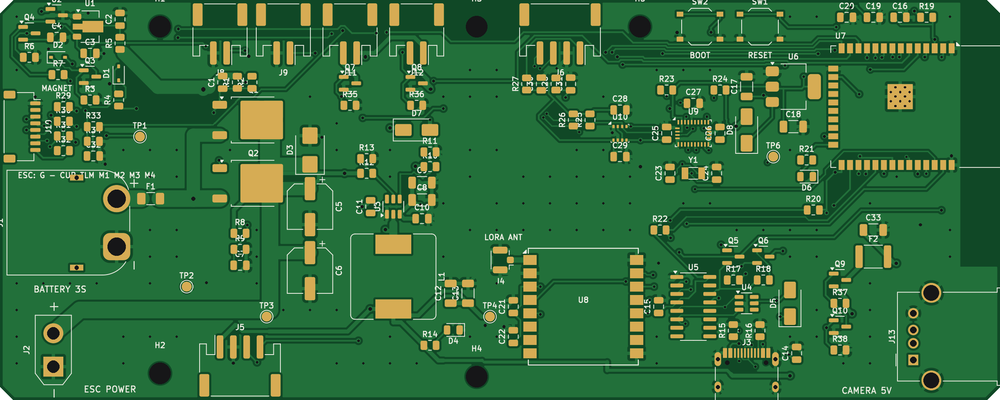

# 2. Electronics

There are two ways to build the electronics. Both use the same 150 x 60 mm board outline and mounting holes,
so the hull, sled and wiring are the same either way.

| | Rev 1 carrier board ([`pcb/`](../pcb)) | Minnow Core, all-in-one ([`pcb-core/`](../pcb-core)) |
|---|---|---|
| What arrives | A bare PCB. You solder about 90 parts and plug in an ESP32-S3 DevKit and an E220 radio | Two boards, fully assembled by JLCPCB. Nothing to solder |
| Cost | About £95 of parts | About £190–205 for two finished boards (the second one is the shore radio) |
| Electronics you still buy | About 20 separate items | GPS, depth sensor, ESC, motors, battery, camera, two antennas, a magnet, plug-in cables |
| Best if | You want the cheapest build and like soldering | You want the fewest things to buy and no soldering |

Sections 2.1 to 2.9 describe the rev 1 carrier board. [Section 2.10](#210-the-minnow-core-board) sums up how the
Core board differs, and [`pcb-core/README.md`](../pcb-core/README.md) has its full guide (ordering, pin map,
first power-up).

### The rev 1 carrier board

The electronics live on one custom carrier board (the "main board") that the ESP32-S3 dev board and the
LoRa module plug into. Everything else connects to it with keyed JST connectors, so nothing is held on with
jumper wires. The board is designed in KiCad and fully routed. The Gerbers are ready to order:
[`pcb/output/auv-mainboard-gerbers.zip`](../pcb/output/auv-mainboard-gerbers.zip).

* 150 x 60 mm, 2 layers, 1.6 mm, ground pour on both sides. 91 footprints, 58 nets, 974 track segments, 64 vias.
* KiCad design-rule check: **0 errors, 0 unconnected pads** (only silkscreen cosmetics remain).
* Schematic: [`pcb/output/auv-mainboard-schematic.pdf`](../pcb/output/auv-mainboard-schematic.pdf).
* Every part, value and suggested part number: [`pcb/output/auv-mainboard-bom.csv`](../pcb/output/auv-mainboard-bom.csv) (about £13 of parts).

## 2.1 Power system

**Battery.** One or two 3S1P 18650 Li-ion packs (11.1 V nominal, 12.6 V full, 9.0 V empty) with a BMS
and an XT60 lead. Li-ion steel cells are tougher than LiPo pouches in a sealed tube. **Always charge them
outside the hull.**

**Fuse.** A 15 A ATO blade fuse in board-mounted clips protects everything, including the wiring, if a
thruster stalls or water gets in.

**Magnet soft-latch switch.** There is no switch through the hull. A glass reed switch is stuck to the
inside of the hull top, under the white ring on the outside:

1. Hold the magnet on the white ring. The reed switch closes, Q3 turns on, and Q3 pulls the gates of the
   two P-MOSFETs low, so the sub powers up.
2. The ESP32 boots (about 0.5 s) and drives `PWR_HOLD` (GPIO21) high. That keeps Q3 on, so power stays on
   after you take the magnet away.
3. To switch off, hold the magnet there for 3 seconds. The firmware sees it on `MAG_SENSE` (GPIO6), stops
   the motors, closes the log file and drops `PWR_HOLD`. Power goes off once you remove the magnet.
   The firmware can also switch itself off, for example after a mission or on a flat battery.

When off, the circuit draws only the FETs' leakage (microamps). The two FETs in parallel share the motor current.
The 15 V Zener protects their gates, and a 100 nF gate capacitor gives a soft start so the ESC's
capacitors do not spark the contacts.

**5 V rail.** An LM2596S-5.0 buck regulator (3 A) feeds the ESP32, GPS, LoRa radio and the camera. Its tab
is stitched to the ground pour with six vias for cooling. The DevKit is fed through an SS34 diode, so
plugging a USB cable into the DevKit while the sub is on cannot back-feed your computer.

**Power budget (estimates).**

| Load | Typical |
|---|---:|
| ESP32-S3 with Wi-Fi to the camera | 0.6 W |
| GPS, IMU, depth, BME280 | 0.2 W |
| LoRa (average, one short packet every 10–30 s) | < 0.1 W |
| GoPro recording 4K30 (powered by the sub) | 4–5 W |
| Two horizontal thrusters cruising | 5–7 W |
| Two vertical thrusters holding depth | 2–3 W |
| **Total** | **about 13–16 W** |

One 3S1P pack (about 38 Wh, 80 % usable) gives roughly 2 hours; two packs, roughly 4 hours.

## 2.2 Main board connectors

Pin 1 of every connector is marked on the silkscreen. All JST PH are 2.0 mm pitch, JST XH are 2.5 mm.

| Ref | Label | Type | Pins (1 -> n) | Goes to |
|---|---|---|---|---|
| J1 | BATTERY | XT60 male | -, + | Battery pack (XT60 female lead). Check the + marks before plugging in |
| J2 | ESC POWER | XT30 female | -, + | 4-in-1 ESC power lead (XT30 male, 14 AWG) |
| J11 | ESC SIGNAL | PH 7 | GND, CURR, TLM, M1, M2, M3, M4 | 4-in-1 ESC signal harness (re-pin it to this order) |
| J4 | (socket) | 7-pin female header | M0, M1, RXD, TXD, AUX, VCC, GND | Ebyte E220-900T22D plugs in here |
| U2 | (sockets) | 2 x 22-pin female headers | J1 row / J3 row | ESP32-S3-DevKitC-1 plugs in here, antenna end over the board edge |
| J5 | GPS | PH 4 | 5V, GND, TX (from GPS), RX (to GPS) | BN-220 in the mast |
| J6 | IMU | PH 5 | 3V3, GND, SDA, SCL, INT | BNO085 on the IMU bracket |
| J7 | DEPTH | PH 4 | 3V3, GND, SDA, SCL | MS5837 depth sensor in the rear cap |
| J8 | I2C AUX | PH 4 | 3V3, GND, SDA, SCL | BME280 hull monitor (**set it to address 0x77**) |
| J9 | LEAK FRONT | PH 2 | SENSE, GND | Leak probe under the camera |
| J10 | LEAK REAR | PH 2 | SENSE, GND | Leak probe behind the rear cap |
| J3 | REED SWITCH | PH 2 | VBAT (through 1 kΩ), REED_OUT | Reed switch on the hull top |
| J12 | AUX1 STROBE | XH 2 | +VSYS, switched - | Strobe LED in the mast (with its own resistor) |
| J13 | AUX2 LIGHT | XH 2 | +VSYS, switched - | Spare 1 A output (lights, a pump; add a diode at the load if it is a motor) |
| J14 | CAMERA 5V | XH 2 | +5 V (switched, 1.5 A polyfuse), GND | USB-A socket breakout -> camera's USB cable |
| J15 | CAM BUTTONS | PH 4 | A+, A-, B+, B- | Optional: wires soldered across a budget camera's buttons (opto-isolated) |
| TP1–TP5 | | test pads | ESC_TLM, GND, VSYS, +5V, +3V3 | Meter probes during bring-up |

## 2.3 ESP32-S3 pin map

The pin order of the DevKit's headers was checked against Espressif's user guide (v1.1) and their own KiCad
footprint (the rows are 0.9" = 22.86 mm apart). All analog inputs are on ADC1 (GPIO1–10) because ADC2 cannot
be used while Wi-Fi is on, and Wi-Fi is how the sub talks to the camera.

| GPIO | Signal | Notes |
|---|---|---|
| 1 | VBAT_SENSE | ADC1. VBAT x 22/122 (12.6 V -> 2.27 V) |
| 2 | ESC_CURR_F | ADC1. ESC current-sensor output through a 1 kΩ / 100 nF filter |
| 3 | AUX1_EN | Strobe MOSFET |
| 4 | LEAK_F | ADC1. 100 kΩ pull-up: dry ≈ 3.3 V, wet < 1.5 V |
| 5 | LEAK_R | ADC1. Same |
| 6 | MAG_SENSE | ADC1. Reed switch state, VBAT x 22/122 when the magnet is present |
| 7 | IMU_INT | BNO085 interrupt |
| 8 / 9 | SDA / SCL | I²C bus, 4.7 kΩ pull-ups: BNO085 0x4A, MS5837 0x76, BME280 0x77 |
| 10 / 11 / 12 / 13 | ESC_M4 / M1 / M2 / M3 | DShot300 through 100 Ω resistors. M1 = H-port, M2 = H-stbd, M3 = V-port, M4 = V-stbd |
| 14 | CAM_EN | Camera 5 V on/off |
| 15 / 16 | LORA_RXD / LORA_TXD | UART to the E220 (ESP TX -> E220 RXD) |
| 17 / 18 | GPS_RXD / GPS_TXD | UART to the GPS (ESP TX -> GPS RX) |
| 21 | PWR_HOLD | Keeps the power latch on |
| 39 / 40 / 41 | LORA_M0 / M1 / AUX | E220 mode pins and busy flag |
| 42 / 47 | CAM_BTN_A / B | Opto-isolated "button presses" |
| 45 | AUX2_EN | Spare MOSFET output (strapping pin, pulled low at boot) |
| 0, 46, 38/48 | (free) | GPIO46 is spare. GPIO38 or 48 drives the DevKit's RGB LED |
| 19 / 20 | (free) | Native USB. Program the board through the port marked **UART** |
| 35–37 | (not available) | Used by the octal PSRAM on N8R8 / N16R8 modules |

## 2.4 Wiring harness

| Cable | From | To | Wire | Length |
|---|---|---|---|---|
| Battery | Battery pack | J1 XT60 | Pack's own 14 AWG lead | as supplied |
| ESC power | J2 XT30 | ESC power pads | 14 AWG silicone pair | 12 cm |
| ESC signals | J11 | ESC 8-pin harness | ESC's own harness, re-pinned | 15 cm |
| Thrusters x4 | ESC motor pads | gland -> motor | 3-core 0.5 mm² | 0.6–0.7 m each |
| Mast | J5 (GPS) + J12 (strobe) | gland 1 -> mast | 6-core cable | 0.45 m |
| LoRa antenna | E220 SMA | gland 2 -> mast | RG178 pigtail, SMA-male to u.FL + FPC antenna | 0.5 m |
| IMU | J6 | BNO085 | 5 x 26 AWG twisted | 0.3 m |
| Depth | J7 | MS5837 in the rear cap | 4 x 26 AWG | 0.25 m |
| Hull monitor | J8 | BME280 on the sled | 4 x 26 AWG | 0.15 m |
| Leak front / rear | J9 / J10 | probes at the two ends | 2 x 26 AWG | 0.35 / 0.2 m |
| Reed switch | J3 | reed switch on the hull top | 2 x 26 AWG, inline PH plug so the sled can come out | 0.3 m |
| Camera power | J14 | USB-A breakout -> USB-A to USB-C cable -> GoPro | 22 AWG pair | 0.3 m |

Motor numbering is fixed in firmware (M1 = H-port ... M4 = V-stbd). If a thruster spins the wrong way,
fix it in software (DShot "spin direction" or a sign in the mixer) instead of re-soldering inside the hull.

## 2.5 Sensors

* **GPS, Beitian BN-220.** u-blox M8-class module with a built-in patch antenna, 9600 baud by default.
  The firmware switches it to 115200 baud and 5 Hz with UBX commands. It only works at the surface,
  so the mast keeps it above the water.
* **IMU, BNO085.** Does sensor fusion on the chip. Use the *rotation vector* report (magnetometer-corrected
  heading) at 50–100 Hz. Mount it flat and square on the IMU bracket. Calibrate it in the finished sub
  (slow figure-eights on land), away from steel. The ballast is lead and the screws are stainless so they
  don't disturb the compass.
* **Depth, MS5837-30BA.** 0–30 bar absolute, about 2 mm of water resolution. Depth (m) = (P - P_surface) / (ρ·g)
  with ρ = 997 kg/m³ for fresh water. P_surface is measured at power-up. It also gives water temperature.
  If you buy the bare module, pot it inside an M10 hollow bolt with only the gel-filled sensor cap exposed.
* **Hull monitor, BME280.** Pressure, humidity and temperature *inside* the hull. Its main job is a
  pre-dive check: after you pull a slight vacuum, the firmware refuses to dive unless the pressure stays put.
  A sudden humidity rise underwater means a leak. **Address:** most breakouts default to 0x76, which clashes
  with the depth sensor. Tie SDO high (or move the solder jumper) to make it 0x77.
* **Leak probes.** Two short pairs of bare tinned wire (or a strip of stripboard) at the lowest point at each end
  of the hull. Fresh water between them pulls the ADC reading down. The firmware reacts in under 0.1 s.
* **Battery and current.** VBAT from a 100 kΩ / 22 kΩ divider; total motor current from the ESC's current output.

## 2.6 The 4-in-1 ESC

* Any 30–45 A, 2–6S 4-in-1 ESC running BLHeli_S, Bluejay or AM32 with DShot works. Mount it on the ESC tray
  (30.5 mm hole pattern) and connect power through J2 and signals through J11.
* **Reversible ("3D") mode** is needed so the thrusters can push both ways. The firmware enables it once by
  sending DShot command 10 (3D mode on) and then command 12 (save settings), each repeated 10 times, while the
  motors are stopped. In 3D mode, throttle values 1048–2047 spin one way and 48–1047 the other way; 0 is stop.
  (Command numbers and ranges are from Betaflight's DShot command list.) You can also set it with an ESC
  configurator on a PC.
* Limit thrust in firmware to about 60 % so the total current stays well under the 15 A fuse.

## 2.7 LoRa telemetry radio

* Ebyte E220-900T22D (LLCC68 chip, UART interface). Modes: M0 = M1 = 0 is normal transmit/receive;
  M0 = M1 = 1 is sleep/configuration. Default UART 9600 baud.
* **UK / EU radio rules:** use **channel 18 (about 868.1 MHz**: the 900 MHz E220 runs from 850 MHz plus the
  channel number in 1 MHz steps) at **13 dBm** (POWER_13 in the Arduino library, about 20 mW, inside the 25 mW
  limit for the 868.0–868.6 MHz band), and keep to a 1 % duty cycle. In practice, send a
  short binary status packet (about 24 bytes) every 10–30 seconds, only when surfaced.
* The shore side is a second E220 on a USB-serial adapter plugged into a laptop or phone (see the software doc).

## 2.8 Ordering and building the board

1. Upload `auv-mainboard-gerbers.zip` to JLCPCB or PCBWay: 2 layers, 1.6 mm, 150 x 60 mm, any colour, HASL
   (lead-free) is fine, 5 boards. Minimum track is 0.15 mm and minimum drill is 0.35 mm, which every fab handles.
2. Order the parts in `auv-mainboard-bom.csv` (the `part` column lists suggested parts). Everything is 0805 /
   SOT-23 or bigger, so you can hand-solder it.
3. Solder in this order: small SMD parts (resistors, capacitors, diodes, SOT-23 FETs), then the DPAK FETs and the
   LM2596 (use a big tip for their tabs), then the through-hole connectors, sockets, electrolytics, the inductor
   and the fuse clips last.
4. **First power-up, before plugging in the DevKit or any modules:** use a bench supply set to 12 V with a 0.2 A
   current limit on J1. Nothing should happen (the latch is off). Short J3's pins (or use the reed switch). VSYS
   should now read about 12 V and +5V about 5.0 V. Release, and it switches off again. Then plug in the DevKit,
   flash the bring-up firmware, and check that it holds power by itself.
5. Check every connector with the meter against section 2.2 before plugging anything into it, especially
   battery polarity on J1.

## 2.9 Regenerating the board

The KiCad files are generated from [`pcb/design.py`](../pcb/design.py) by
[`pcb/generate_board.py`](../pcb/generate_board.py). The steps are: write the schematic, check that KiCad's netlist
matches the design table, place parts and check for overlaps, autoroute with Freerouting, run DRC, then write
the Gerbers, BOM and images. To change something (a pin, a part, a position), edit `design.py` and run
`python3 generate_board.py all`. You can of course also open the project in KiCad 7 or newer and edit it there.

## 2.10 The Minnow Core board

The Core board does the same jobs as the rev 1 board, with every part soldered by JLCPCB.

* **Power:** the same high-side switch idea (two AOD4185 P-MOSFETs, 15 A fuse, 18 V surge clamp). The reed switch
  is replaced by a Honeywell SM351LT magnet sensor on the port edge of the board, powered all the time by a
  2.5 µA regulator. Hold a magnet on the left side of the hull, level with the board, 53 mm behind the middle
  clamp's centre. The ESP32 then holds power on with GPIO32. The board draws about 3 µA when off.
* **5 V:** a TPS54302 synchronous buck (3 A, 28 V) instead of the LM2596. **3.3 V:** an AMS1117 fed from either
  the 5 V rail or USB through two diodes, so a USB cable on its own powers the ESP32, sensors and radio but
  never the battery side.
* **ESP32:** the classic ESP32-WROOM-32E module (JLCPCB doesn't stock the ESP32-S3 module), with USB-C, a
  CH340C USB serial chip and automatic reset for uploads. Its antenna points forward, towards the camera.
* **On-board sensors:** BNO055 compass/IMU (at the front of the board, away from the battery current) and BME280
  hull monitor.
* **LoRa:** Ra-01H (SX1276, 868 MHz) with a U.FL antenna socket. A second Core board on USB is the shore station.
* **Sockets:** side-entry JST-PH for GPS, depth, leak probes, strobe and AUX; JST-SH 8-pin for the ESC
  cable; USB-A for the camera; XT60 in and XT30 out.
* Pin map, connector pinouts, cost and the ordering steps: [`pcb-core/README.md`](../pcb-core/README.md).

