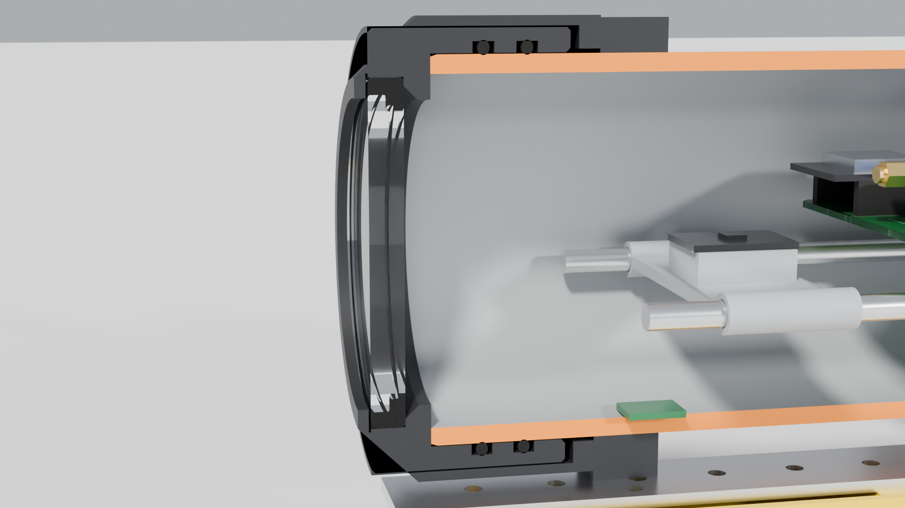

# 3. The 4K camera

The camera rides **inside** the dry hull, right behind the 8 mm acrylic window in the front cap. The sub
powers it, starts and stops it, and the footage comes out on the camera's own microSD card after each mission.

## 3.1 Which camera

| Option | Video | Price (late 2026, used) | Why |
|---|---|---|---|
| **GoPro HERO5 Black (recommended)** | Native 4K at 30 fps | about £40–55 | Real 4K, good optics, controllable over Wi-Fi, waterproof to 10 m on its own (it survives if the hull leaks) |
| GoPro HERO6 Black | 4K at 60 fps, better stabilisation | about £55–70 | Same body and cradle, same Wi-Fi commands |
| GoPro HERO7 Black | 4K60 + HyperSmooth stabilisation | about £70–90 | Same body and cradle, same Wi-Fi commands |
| Budget action camera | "4K" | £30–50 new | Many cheap cameras **upscale** 2.7K to 4K. Only buy one that reviews show records *native* 3840 x 2160 and runs from USB power |

The HERO5/6/7 Black share one body, about 62 x 45 x 33 mm, so the cradle fits all three. **Measure
your camera** and put its size and lens position into `build_sub.py` (`cam_w`, `cam_h`, `cam_d`,
`cam_lens_y`, `cam_lens_z`, `cam_bump`) if it is different, then reprint the cradle. The window aperture is
70 mm wide, so lenses up to about 15 mm off-centre are fine.

## 3.2 How it is mounted

* The camera sits in a printed cradle on the front of the sled, with 3 mm of foam behind it. When the sled slides
  in, the foam pushes it gently forward until the lens is about 2 mm behind the window.
* A **black foam ring** around the lens touches the inside of the window. Without it, light bouncing inside
  the hull reflects off the window into the lens.
* In the camera's settings, **turn its LEDs off** and its beeps down. A recording light right behind the window
  shows up in the footage.

## 3.3 Underwater optics

* A flat window works like a magnifier underwater: everything looks about 1.33 times bigger and the field of
  view gets narrower. A GoPro "Wide" view of about 120 degrees across in air becomes roughly 80–85 degrees underwater.
  Use the widest setting.
* The edges of the frame will be a little soft with some colour fringing. That is normal for flat ports.
* Water absorbs red light first. In a pool, footage looks blue; in a UK lake it looks green-brown and
  visibility may be only 1–3 m. Record with **Protune on, "Flat" colour, white balance "Native"** and
  colour-correct afterwards. That gives much better results than the camera's automatic settings.
* For murky water, the spare switched output (AUX2, 1 A) can drive external LED lights later. Lights must be
  *outside* the window, never behind it, or they will glare.

## 3.4 Power

The camera is powered from the sub so it can record for the whole mission (hours, not the 60–90 minutes its
own battery lasts):

* Main board J14 (CAMERA 5V) -> a USB-A socket breakout -> the camera's normal USB-A to USB-C cable.
* **Bridge D+ to D- on the USB-A breakout** (one solder blob). Chargers do this to tell the device it may draw
  more than 0.5 A.
* The ESP32 switches the 5 V on and off (CAM_EN, GPIO14) through a P-MOSFET and a 1.5 A self-resetting fuse.
* Leave the camera's own battery in as a buffer.

## 3.5 Starting and stopping recording

**GoPro HERO5 / 6 / 7 (Wi-Fi).** These cameras have a Wi-Fi access point and accept simple HTTP commands.
The ESP32 joins the camera's network as a normal Wi-Fi client. Inside the hull the two are 10–20 cm apart,
so the signal is strong even underwater.

| Action | Command (from the community "goprowifihack" documentation for HERO5 and HERO7) |
|---|---|
| Camera address | `10.5.5.9` |
| Start recording | `GET http://10.5.5.9/gp/gpControl/command/shutter?p=1` |
| Stop recording | `GET http://10.5.5.9/gp/gpControl/command/shutter?p=0` |
| Go to sleep | `GET http://10.5.5.9/gp/gpControl/command/system/sleep` |
| Wake up | Wake-on-LAN "magic packet" (UDP) to `10.5.5.9`, port 9 |

Setup, once: switch on the camera's Wi-Fi (Connections -> Wireless Connections -> On), read its network name
and password from the same menu (on some models you pair it with the GoPro app once first), and put them in
the sub's configuration page. The firmware:

1. powers the camera at mission start, waits for its Wi-Fi network and connects;
2. sends **start recording** once the sub is armed and in the water;
3. sends **stop recording** at the end of the mission, or if a failsafe triggers, so the file is closed properly;
4. checks every few seconds that the camera is still reachable and logs it if not.

**Budget cameras.** There are two ways to control a camera without Wi-Fi commands:

* Many cameras have a "car mode" or "auto-record on power" setting. Then switching CAM_EN on and off starts
  and stops the recording, and nothing else is needed.
* Otherwise, open the camera and solder two thin wires across its record button (and optionally the power button).
  Connect them to J15 (CAM BUTTONS). The board "presses" them through PC817 opto-isolators, so the camera's
  electronics never connect to the sub's. Do not do this to a GoPro: opening it breaks its waterproofing.

## 3.6 Recording settings

| Setting | Value |
|---|---|
| Resolution / rate | 4K 30 fps (HERO6/7: 4K 30 or 60) |
| Field of view | Wide |
| Protune | On: Flat colour, Native white balance, ISO max 800–1600, sharpness low |
| Stabilisation | On where the camera supports it at 4K (HERO7: HyperSmooth) |
| LEDs / beeps | LEDs off, beeps low or off |
| Auto power-off | Never (the sub controls power) |
| microSD | 64 GB U3 / V30. 4K30 at 60 Mb/s is about 27 GB per hour, so about 2.3 hours |

## 3.7 Heat

Recording 4K makes about 4–5 W of heat. Underwater, the hull is cooled by the water around it, so the camera
stays comfortable. On a sunny bench with the hull closed it can overheat in 20–30 minutes, so the firmware only
starts recording when the mission starts, and stops if the hull temperature (from the BME280) passes 45 °C.

## 3.8 Matching video to the dive log

At the start of every mission the sub "beeps" its motors (DShot beacon command) for one second. The camera's
microphone records the beep, and the log records the time it happened, so you can line up the video with the
depth, heading and position log afterwards. That is enough to overlay depth and heading on the footage with a
small script or a telemetry-overlay app.
