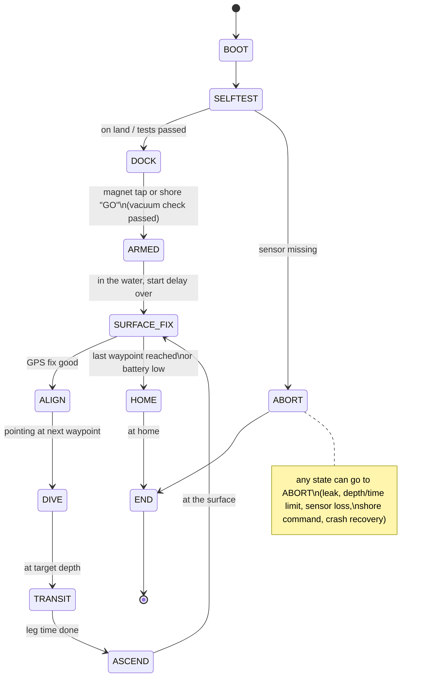

# 4. Software and autonomy

This is the design of the firmware that runs on the ESP32-S3, and of the small shore station. It describes
every module, the mission state machine, the control loops, navigation, failsafes and data formats, so the
code can be written (and tested) one piece at a time.

## 4.1 Toolchain and libraries

* **Arduino-ESP32 core 3.x** (built on ESP-IDF 5), using PlatformIO or Arduino IDE 2. Board: ESP32-S3-DevKitC-1
  with PSRAM enabled. Upload through the DevKit's **UART** USB port (the native USB pins are left free).
* Libraries:

| Job | Library |
|---|---|
| IMU (BNO085) | Adafruit BNO08x |
| Depth sensor (MS5837) | Blue Robotics MS5837 Arduino library |
| Hull monitor (BME280) | Adafruit BME280 |
| GPS (NMEA) | TinyGPSPlus (or the SparkFun u-blox GNSS library to use UBX messages) |
| LoRa (E220) | EByte LoRa E220 library by Renzo Mischianti |
| Thrusters (DShot) | ESP-IDF RMT peripheral, following IDF's `dshot_esc` RMT example |
| Missions and settings | ArduinoJson, stored in LittleFS |
| Logs | LittleFS binary log, downloaded over Wi-Fi as CSV |
| Bench web page and updates | Web server + Update (over-the-air firmware) |

> **Building the Minnow Core board?** It uses the classic ESP32 (board "ESP32 Dev Module"), a BNO055 compass
> (library *Adafruit BNO055*) and a Ra-01H LoRa radio driven with *RadioLib*; the shore station is a second Core
> board on USB. Its pin map and library settings are in [`pcb-core/README.md`](../pcb-core/README.md#esp32-pin-map).
> Everything else in this chapter (state machine, control loops, failsafes, telemetry format) is the same.

## 4.2 Structure

The firmware is a set of FreeRTOS tasks that share one "vehicle state" structure protected by a mutex:

| Task | Rate | Does |
|---|---|---|
| `control` | 50 Hz | Reads IMU + depth, runs the depth / heading / roll controllers, mixes and sends DShot to the 4 motors |
| `mission` | 5 Hz | The state machine below: waypoints, dives, surfacing, dead reckoning |
| `gps` | as data arrives | Parses GPS, keeps the latest fix with its quality (satellites, HDOP) |
| `health` | 10 Hz | Leak probes, battery, motor current, hull pressure/humidity/temperature, sensor timeouts. Can override everything |
| `camera` | 1 Hz | Keeps the Wi-Fi link to the camera, sends start/stop, checks it is alive |
| `radio` | when surfaced | Sends LoRa status packets (duty-cycle limited), listens for shore commands |
| `logger` | 10 Hz | Writes binary records to LittleFS |
| `dock` | on land only | Wi-Fi access point + web page for setup, bench tests, mission upload, log download, updates |

`health` runs at a higher FreeRTOS priority than everything except `control`. The ESP32's task watchdog
watches `control` and `health`.

## 4.3 Mission state machine



| State | What happens |
|---|---|
| `SELFTEST` | Checks every sensor answers, battery above 11.0 V, leak probes dry, camera reachable (warning only). Zeroes the depth sensor. |
| `DOCK` | On land: web page at `http://192.168.4.1` on the sub's own Wi-Fi network. Thrusters only spin in the bench-test page, and only for 2 s at 15 %. |
| `ARMED` | Waits for a magnet tap or a shore "GO", then a start delay (default 30 s). Before arming it runs the **vacuum check**: hull pressure must stay within 2 hPa for 5 minutes. |
| `SURFACE_FIX` | Floats, waits for a GPS fix (HDOP < 2, at least 6 satellites, averaged over 5 s), sends a LoRa status packet, corrects the dead-reckoning position. |
| `ALIGN` | Runs straight along the surface at low power for 10 s. Compares GPS course with the compass and stores the difference. This removes compass error (hard-iron, magnetic declination) before each dive. Then turns to the bearing of the next waypoint. |
| `DIVE` | Vertical thrusters push down to the target depth (default 1.5 m) at up to 0.3 m/s. |
| `TRANSIT` | Holds depth, heading and a set speed for the leg time (at most 90 s by default). Camera recording. |
| `ASCEND` | Horizontal thrust off, vertical thrusters push gently up, then switch off near the surface and it floats up the last part. |
| `HOME` | Same dive / surface cycle towards the start point. |
| `END` | Motors off, strobe flashing, LoRa position every 30 s, camera stopped. Waits to be picked up. |
| `ABORT` | Motors off (and a short push up), strobe SOS pattern, LoRa SOS, log saved. The sub floats up because it is trimmed positive. |

## 4.4 Control loops (50 Hz)

All outputs are normalised thrust from -1 to +1, sent to the ESC as DShot 3D throttle. They are clipped to
±0.6, and changes are rate-limited to 2.0 per second so the sub never jerks or browns out.

**Depth (vertical thrusters together):**

```
e      = depth_target - depth                       (metres, positive = too shallow)
u_v    = ff + Kp*e + Ki*integral(e) - Kd*depth_rate
ff     = thrust that just cancels the 45 g reserve buoyancy (measure it in the pool, about 0.08-0.12)
start: Kp = 0.5 per m, Ki = 0.05 per m*s (clamped to +-0.2), Kd = 0.8 per m/s
```

**Heading (horizontal thrusters differential):**

```
e_psi  = wrap(heading_target - heading)             (degrees, -180..180)
u_d    = Kp*e_psi - Kd*yaw_rate                     (yaw_rate from the gyro, deg/s)
start: Kp = 0.008 per degree, Kd = 0.010 per deg/s
H_port = surge + u_d,   H_stbd = surge - u_d
```

**Roll (vertical thrusters differential):** usually close to zero because the weight is 15 mm below the centre of
buoyancy. A small `Kp_roll = 0.01 per degree` cancels the twist from the propeller torque.

```
V_port = u_v + u_roll,  V_stbd = u_v - u_roll
```

**Tuning in the pool**, one loop at a time: start with only Kp, raise it until the sub just starts to oscillate
around the target, halve it, then add Kd until the overshoot disappears, then a little Ki to remove any steady offset.
Log every run and plot it.

## 4.5 Navigation

There is no position underwater, so the sub estimates it (dead reckoning) and corrects it at every surfacing:

* **Local map:** the start point is the origin. GPS fixes become metres east and north
  (`east = (lon - lon0) * cos(lat0) * 111320`, `north = (lat - lat0) * 110540`).
* **Speed model:** a small table of speed against thrust, measured in the pool (time it over 10 m at 20, 30, 40, 50 %).
* **Dead reckoning (50 Hz):** `east += (v*sin(psi) + c_e)*dt`, `north += (v*cos(psi) + c_n)*dt`, with heading psi
  measured clockwise from north and (c_e, c_n) the estimated water current.
* **At each surfacing:** error = GPS position - estimated position. Part of that error divided by the dive time
  is added to the current estimate (`c += 0.5 * error / dive_time`), and the position is reset to GPS.
* **Planning a leg:** bearing from the corrected position to the waypoint; leg time = distance / speed, capped
  at the maximum leg time. A waypoint counts as reached when the surfacing fix is within its radius (default 5 m).

Typical accuracy: a few metres per minute underwater, back to GPS accuracy (2–4 m) at every surfacing.

## 4.6 Thrusters: DShot setup

* DShot300 on four RMT channels (GPIO11, 12, 13, 10 = M1–M4). The value is 11 bits plus a telemetry bit and a
  4-bit checksum, as in the ESP-IDF RMT DShot example.
* **One-time setup** (motors stopped): send command 10 (3D mode on) ten times, then command 12 (save settings)
  ten times, then power-cycle the ESC.
* **3D throttle:** 0 = stop; 1048–2047 = one direction from slow to fast; 48–1047 = the other direction.
  The mixer turns ±1 into those ranges and keeps a deadband around zero.
* **Beeps:** DShot commands 1–5 make the motors beep. They are used for status sounds and for the start-of-video
  sync mark.

## 4.7 Failsafes

`health` checks these every 100 ms. The first one that triggers wins.

| Trigger | How it is detected | Action |
|---|---|---|
| Leak | Either probe below threshold for 3 readings | ABORT, LoRa "LEAK", head home on the surface if possible |
| Hull vacuum not holding (before a dive) | Hull pressure rises > 2 hPa in 5 minutes | Refuse to dive, error beeps |
| Hull humidity jump (underwater) | Relative humidity up more than 10 points | ABORT |
| Too deep | Depth > max depth (default 5 m, never above 10 m) | ASCEND at once |
| Dive too long | Leg time + 30 s | ASCEND |
| Depth or IMU data stops | No new reading for 0.5 s | ABORT |
| Battery low | Below 3.4 V per cell (10.2 V) under load | HOME on the surface |
| Battery critical | Below 3.2 V per cell (9.6 V) | END: motors off, beacon only |
| Motor over-current | Above 12 A for 1 s | Halve the thrust limit; repeated, ABORT |
| Outside the area | GPS fix outside the mission's boundary polygon | Stop, beacon, wait |
| Shore command | "ABORT" / "HOME" over LoRa (at the surface) | As commanded |
| Crash or watchdog reset | ESP32 reset reason at boot | If deeper than 0.3 m: no thrust, float up, beacon |
| Hull too hot | Hull temperature > 45 °C | Stop the camera; above 55 °C, ABORT |
| Mission too long | Total time limit | HOME |

## 4.8 Missions

Missions are JSON files uploaded from the bench web page:

```json
{
  "name": "pool-square",
  "max_depth_m": 2.0,
  "max_leg_s": 60,
  "cruise_thrust": 0.30,
  "boundary": [[51.50010, -0.12010], [51.50010, -0.11950], [51.49970, -0.11950], [51.49970, -0.12010]],
  "waypoints": [
    {"lat": 51.50000, "lon": -0.12000, "depth_m": 1.0, "radius_m": 4, "record": true},
    {"lat": 51.50000, "lon": -0.11960, "depth_m": 1.5, "radius_m": 4, "record": true},
    {"lat": 51.49980, "lon": -0.11960, "depth_m": 1.0, "radius_m": 4, "record": true}
  ],
  "return_home": true
}
```

The firmware rejects a mission if a waypoint is outside the boundary, a depth is deeper than `max_depth_m`,
or the estimated energy needed is more than 70 % of the battery.

## 4.9 Telemetry and the shore station

**Sub to shore** (LoRa, 22 bytes, little-endian, sent only at the surface, every 10–30 s to respect the 1 % duty cycle):

```c
struct __attribute__((packed)) Status {
  uint8_t  magic;         // 0xA5
  uint8_t  state;         // mission state number
  uint16_t seq;
  int32_t  lat_e7, lon_e7;  // degrees x 1e7
  int16_t  depth_cm;
  uint16_t heading_cdeg;  // 0..35999
  uint16_t vbat_mv;
  uint8_t  flags;         // bit0 leak, bit1 low battery, bit2 GPS fix, bit3 recording, bit4 abort
  uint8_t  waypoint;
  int8_t   water_temp_c;
  uint8_t  crc8;          // CRC-8 of the bytes before it
};
```

**Shore to sub:** short text commands with a checksum, accepted only at the surface: `GO`, `HOME`, `ABORT`, `PING`.

**Shore station:** the second E220 on a USB-serial adapter (M0 and M1 tied to GND), plugged into a laptop or a
phone with a USB-OTG serial terminal. A minimal laptop script:

```python
import struct, serial
FMT = '<BBHiihHHBBbB'                       # matches struct Status (22 bytes)
SIZE = struct.calcsize(FMT)

def crc8(data):
    c = 0
    for b in data:
        c ^= b
        for _ in range(8):
            c = ((c << 1) ^ 0x07) & 0xFF if c & 0x80 else (c << 1) & 0xFF
    return c

port = serial.Serial('/dev/ttyUSB0', 9600, timeout=1)
buf = b''
while True:
    buf += port.read(64)
    i = buf.find(b'\xa5')
    if i < 0:
        buf = b''
        continue
    if len(buf) - i < SIZE:
        buf = buf[i:]
        continue
    pkt, buf = buf[i:i + SIZE], buf[i + SIZE:]
    f = struct.unpack(FMT, pkt)
    if crc8(pkt[:-1]) != f[-1]:
        continue
    print(f'state {f[1]} wp {f[9]}  {f[3] / 1e7:.6f},{f[4] / 1e7:.6f}  depth {f[5] / 100:.2f} m  '
          f'heading {f[6] / 100:.0f}  battery {f[7] / 1000:.2f} V  flags {f[8]:05b}')
```

## 4.10 Logging

Every 0.1 s: time, state, estimated east/north, depth, heading, pitch, roll, the four thrust commands, battery
voltage, motor current, both leak readings, hull pressure / humidity / temperature, water temperature, and the
GPS fix when there is one. About 60 bytes per record, so 16 MB of flash holds several hours. After a
mission, connect to the sub's Wi-Fi on land and download the log as CSV from the web page.

## 4.11 Order to write and test it

| Step | Milestone | Where |
|---|---|---|
| 1 | Power latch, battery reading, magnet on/off, web page | Bench |
| 2 | Every sensor printing sensible values | Bench |
| 3 | DShot: 3D mode, each motor both ways, beeps | Bench, motors in a bucket |
| 4 | Camera: connect, start, stop over Wi-Fi | Bench |
| 5 | Failsafes, tested one by one (wet a leak probe, unplug the depth sensor...) | Bench |
| 6 | Depth hold, then heading hold, then both | Pool |
| 7 | Mission logic with fake GPS and depth (simulation mode on the bench) | Bench |
| 8 | Surface runs (ALIGN), then single dives, then full missions | Pool, then lake on a tether |
