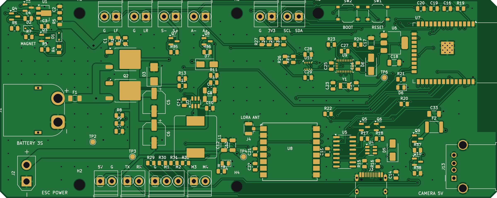
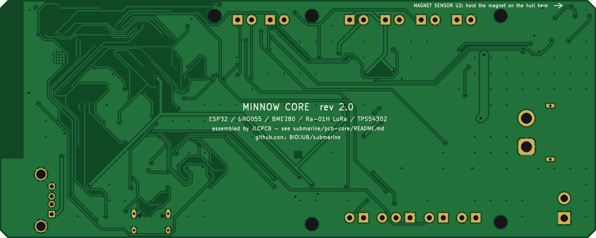
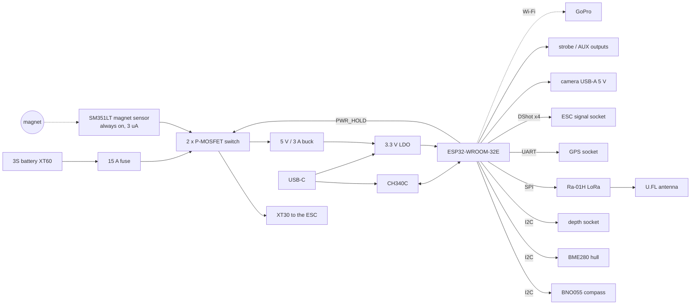

# Minnow Core: the all-in-one board

This is the "buy almost nothing" version of the Minnow electronics. JLCPCB solders **every part** for you:
the ESP32, the USB programming port, the magnet on/off switch, the 5 V and 3.3 V supplies, the compass, the
hull leak/pressure sensor, the LoRa radio and all the connectors. You plug things into it; there is nothing
to solder on the board.

**Order two.** One goes in the sub. The other is your **shore radio**: plug it into a laptop with a USB-C cable
and it talks to the sub over LoRa. You don't need any other radio, USB adapter or base station.

| Top | Bottom |
|---|---|
|  |  |

It has the same outline (150 x 60 mm) and mounting holes as the rev 1 carrier board in [`../pcb`](../pcb), so it
fits the same sled in the hull, and the mechanical design does not change. Two small differences: the magnet mark
moves to the side of the hull (see below), and because the board is lighter than the rev 1 board with its DevKit,
radio and compass bracket, the sub needs about 617 g of lead instead of 579 g (the 1 kg bag covers it). Build the
Blender model with `python3.11 build_sub.py --core` to see it and get the exact trim.

## What is on the board

| Job | Part on the board | Replaces (rev 1) |
|---|---|---|
| Brain | ESP32-WROOM-32E-N8 module (Wi-Fi for the camera, Bluetooth) | ESP32-S3 DevKit |
| Programming / shore link | USB-C + CH340C USB serial, auto-reset, BOOT and RESET buttons | DevKit USB, CH340 adapter |
| Compass / IMU | Bosch BNO055 9-axis sensor with its own sensor fusion, plus a 32.768 kHz crystal | BNO085 breakout |
| Hull monitor | Bosch BME280 (pressure for the vacuum test, humidity for early leak warning) | BME280 breakout |
| Radio | Ai-Thinker Ra-01H LoRa (SX1276, 868 MHz) with a U.FL antenna socket | 2 x E220 modules + USB adapter |
| On/off | Honeywell SM351LT magnet sensor at the board edge + always-on 3 uA supply: hold a magnet on the hull | reed switch on a lead |
| Power | 15 A fuse, two 40 A P-MOSFET switch, 18 V surge clamp, 5 V / 3 A buck (TPS54302), 3.3 V LDO | same idea, through-hole parts |
| Camera power | USB-A socket for the GoPro's own cable, switched by the ESP32, 1.5 A resettable fuse | USB-A breakout on a lead |
| Thrusters | JST-SH 8-pin socket for the 4-in-1 ESC's DShot cable, 1 kΩ protection on every signal | JST-PH 7-pin |
| Outputs | Strobe and spare (lights / pump) low-side switches, up to 3 A each | same |
| Sockets | GPS, depth sensor, 2 leak probes (JST-PH, side entry), XT60 battery in, XT30 to the ESC | same |



## What you still need to buy

The board can't hold the things that must be outside the hull, at the top of the mast or under the
battery. These are the electronics you still buy (the mechanical parts are unchanged, see the
[shopping list](../bom/shopping_list.md)):

| Qty | Item | Why it can't be on the board | Link |
|---:|---|---|---|
| 1 | **GPS** Beitian BN-220 | needs to see the sky from the mast | [Amazon UK](https://www.amazon.co.uk/s?k=Beitian+BN-220+GPS) |
| 1 | **Depth sensor** MS5837-30BA module | must touch the water, through the rear cap | [Amazon UK](https://www.amazon.co.uk/s?k=MS5837-30BA) · [eBay UK](https://www.ebay.co.uk/sch/i.html?_nkw=MS5837-30BA) |
| 1 | **4-in-1 ESC** (BLHeli_S / Bluejay / AM32, 30.5 mm) | 15 A of motor current and its own firmware | [Amazon UK](https://www.amazon.co.uk/s?k=4+in+1+ESC+45A+30.5mm+BLHeli_S) |
| 4 | **Motors** A2212 1000KV | they are the thrusters | [Amazon UK](https://www.amazon.co.uk/s?k=A2212+1000KV+brushless+motor) |
| 1 | **Battery** 3S 18650 pack with BMS and XT60 | (+ charger) | [Amazon UK](https://www.amazon.co.uk/s?k=3S+18650+battery+pack+BMS+11.1V+XT60) |
| 1 | **GoPro** HERO5/6/7 Black + 64 GB card + short USB-A to USB-C cable | the 4K camera | [eBay UK](https://www.ebay.co.uk/sch/i.html?_nkw=GoPro+HERO5+Black) |
| 2 | **868 MHz antennas** with a U.FL plug: one with a ~30 cm cable for the mast, one for the shore board | the antenna must be above water | [Amazon UK](https://www.amazon.co.uk/s?k=868MHz+antenna+IPEX+u.fl) |
| 1 | **Small magnet** (6–10 mm neodymium disc) | it is the on/off key | [Amazon UK](https://www.amazon.co.uk/s?k=N52+neodymium+magnet+10mm+x+5mm) |
| 1 | **JST PH 2.0 pre-crimped cables** (2- and 4-pin), and an XT30 male lead for the ESC | to plug things in | [Amazon UK](https://www.amazon.co.uk/s?k=JST+PH+2.0+connector+kit+pre-crimped) · [XT30](https://www.amazon.co.uk/s?k=XT30+male+pigtail) |
| 1 | Strobe LED (1 W white + 47 Ω 1 W resistor), optional | it sits in the mast | [Amazon UK](https://www.amazon.co.uk/s?k=1W+white+LED+star) |

Compared with the rev 1 board this removes the ESP32 DevKit, the BNO085, the BME280, two E220 radios, the USB
serial adapter, the reed switch, the USB-A breakout, the 38 lines of loose PCB parts and all of the soldering.

## Cost

Rough numbers from JLCPCB's parts library on 2026-11-11 (check the live quote, prices move):

| | USD |
|---|---:|
| Parts for two boards (BNO055 $9, BME280 $8, Ra-01H $6.50 and ESP32 $4.60 each are most of it) | ~80 |
| "Extended part" loading fee, 20 kinds of part x $3 | ~60 |
| Assembly setup, stencil, through-hole soldering for the 3 big connectors | ~35 |
| 5 bare PCBs (2 get assembled, 3 spare) | ~10 |
| Shipping to the UK | ~15–30 |
| **Total before VAT** | **~200–215** |
| **With UK VAT (JLCPCB charges it at checkout)** | **about £190–205** |

The rev 1 parts it replaces (DevKit, PCB and its parts, BNO085, BME280, two E220 radios, USB adapter, reed switch,
USB-A breakout, antenna pigtails) come to about £80, so the Core board costs roughly £110–125 more. In exchange
there is no soldering, the board is assembled and inspected by machine, and you get a second board as the
shore station.

**Ways to bring it down:**
* Leave out the hull monitor U10 (BME280): mark it "do not place" on the BOM page. Saves about £17. The leak
  probes still work, and you lose the automatic vacuum test.
* Choose **Economic** assembly and leave out J1, J2 and J13 (the three through-hole connectors). Solder those
  three yourself (XT60PW-M, XT30UPB-F, USB-A socket, about £5 from Amazon). Saves roughly £20–25.

## Ordering from JLCPCB, step by step

1. Go to [jlcpcb.com/quote](https://cart.jlcpcb.com/quote) and upload
   [`output/minnow-core-gerbers.zip`](output/minnow-core-gerbers.zip). It reads 150 x 60 mm, 2 layers.
2. PCB options: thickness 1.6 mm, quantity 5, any colour, surface finish HASL lead-free (or ENIG). Leave
   everything else at the default.
3. Turn on **PCB Assembly**: **Standard** PCBA (needed for the three through-hole connectors), assemble the
   **top side**, PCBA quantity **2**. Leave "Confirm parts placement" on.
4. Upload [`output/minnow-core-jlcpcb-bom.csv`](output/minnow-core-jlcpcb-bom.csv) as the BOM and
   [`output/minnow-core-jlcpcb-cpl.csv`](output/minnow-core-jlcpcb-cpl.csv) as the CPL (pick-and-place) file.
5. On the parts page every line should match a part (they all carry an LCSC number). If a part shows
   "out of stock", pick the suggested alternative with the same package and value.
6. **Check the placement preview.** The CPL already includes the usual JLCPCB rotation fixes, but look at every
   chip: the dot or notch on the part must match the dot on the footprint, the electrolytic capacitors'
   stripe must be on the minus side, and the USB, JST and XT connectors must face the board edge. Rotate any that
   are wrong right there on the page. JLCPCB's engineers check it again before they build.
7. Pay. Boards usually arrive in about 1–2 weeks.

## Connectors

| Ref | Silkscreen | Pins (1 → n) | Goes to |
|---|---|---|---|
| J1 | BATTERY | 1 −, 2 + (XT60 male) | battery (XT60 female) |
| J2 | ESC POWER | 1 −, 2 + (XT30 female) | 4-in-1 ESC power input |
| J10 | ESC | 1 GND, 2 not used (ESC VBAT), 3 CUR, 4 TLM, 5 M1, 6 M2, 7 M3, 8 M4 (JST-SH 1.0) | 4-in-1 ESC signal cable |
| J5 | GPS | 1 +5 V, 2 GND, 3 TX (from the GPS), 4 RX (to the GPS) | BN-220 |
| J6 | DEPTH (port edge, middle) | 1 +3.3 V, 2 GND, 3 SDA, 4 SCL | MS5837-30BA (address 0x76) |
| J8 / J9 | LEAK F / LEAK R | 1 sense, 2 GND | leak probes (two bare wire ends at the lowest point of the hull) |
| J11 | STROBE | 1 +battery, 2 switched − | strobe LED (with its resistor) in the mast |
| J12 | AUX | 1 +battery, 2 switched − (up to 3 A, flyback diode fitted) | lights or a pump |
| J13 | CAMERA 5V | USB-A, 5 V switched, 1.5 A fuse | GoPro (its own USB cable) |
| J3 | USB | USB-C | laptop: programming, serial monitor, shore station |
| J4 | LORA ANT | U.FL | 868 MHz antenna |

**ESC cable:** 4-in-1 ESCs ship with an 8-pin JST-SH cable but the pin order varies between brands. Compare
your ESC's manual with the table above. GND and the four motor signals are what matter; the motor order can be
changed in the firmware. If your cable's order is different, move the pins in the little plastic housing with a
needle (lift the tab, slide the wire out, push it into the right slot). The board does not use the ESC's VBAT
pin, and every signal has a 1 kΩ resistor, so a mistake will not damage the ESP32.

## Switching it on and off: the magnet

The SM351LT magnet sensor (U2) sits right at the port (left) edge of the board, next to the white arrow
marked MAGNET on the silkscreen. In the hull that point is **on the left side of the hull, level with the
middle of the hull, 53 mm behind the centre of the middle clamp**. Put a sticker or paint mark there.

* **On:** hold the magnet against the mark for a second. The sensor needs only about 1 mT, which a 6–10 mm
  neodymium disc gives through the 4.3 mm pipe wall with plenty to spare. The green 5 V LED and the red status
  LED come on, and the firmware takes over the power switch.
* **Off:** hold the magnet there for 3 seconds. The strobe flashes, you take the magnet away, and it turns off.
* If it doesn't react, turn the magnet 90 degrees. This kind of sensor (magnetoresistive) responds to a field
  along the board, so a magnet held flat against the hull side is the right way.
* Off, the board draws about 3 µA (a 3 Ah pack would take decades to drain), but still disconnect the battery for
  storage and charge it outside the hull.

## ESP32 pin map

| GPIO | Signal | Notes |
|---:|---|---|
| 0 | `ESP_IO0` | BOOT button / auto-program |
| 1 | `ESP_TXD` | USB serial (CH340C) |
| 2 | `LED_STAT` | red status LED |
| 3 | `ESP_RXD` | USB serial (CH340C) |
| 4 | `LORA_DIO0` | LoRa interrupt |
| 5 | `LORA_NSS` | LoRa chip select |
| 12 | `AUX_EN` | AUX output (lights / pump) |
| 13 | `CAM_EN` | camera 5 V on |
| 14 | `STROBE_EN` | strobe output |
| 15 | `MAG_SENSE` | magnet sensor (low = magnet) |
| 16 | `GPS_TX` | UART2 RX <- GPS TX |
| 17 | `GPS_RX` | UART2 TX -> GPS RX |
| 18 | `LORA_SCK` | SPI |
| 19 | `LORA_MISO` | SPI |
| 21 | `SDA` | I2C |
| 22 | `SCL` | I2C |
| 23 | `LORA_MOSI` | SPI |
| 25 | `ESC_M2` | DShot motor 2 |
| 26 | `ESC_M3` | DShot motor 3 |
| 27 | `ESC_M4` | DShot motor 4 |
| 32 | `PWR_HOLD` | keeps the power switch on |
| 33 | `ESC_M1` | DShot motor 1 |
| 34 | `LEAK_F` | leak probe front (ADC1) |
| 35 | `LEAK_R` | leak probe rear (ADC1) |
| 36 | `VBAT_SENSE` | battery voltage x 22/122 (ADC1) |
| 39 | `ESC_CURR_F` | ESC current sensor (ADC1) |

The firmware design in [`../docs/04-software.md`](../docs/04-software.md) applies unchanged apart from these
details for the core board:

* **Board:** "ESP32 Dev Module" (classic ESP32, 8 MB flash). Upload over the USB-C port; the auto-reset
  circuit means you never press BOOT, unless the upload fails (then hold BOOT and tap RESET).
* **Compass:** BNO055 at I2C address 0x28, library *Adafruit BNO055*. Use NDOF mode and switch on the external
  crystal (`bno.setExtCrystalUse(true)`). Run the I2C bus at 100 kHz: the BNO055 holds the clock
  low while it works ("clock stretching"), which the ESP32 handles at that speed.
* **Hull monitor:** BME280 at 0x77 (*Adafruit BME280*). Depth sensor MS5837 at 0x76 on the same bus.
* **LoRa:** *RadioLib*, `SX1276 radio = new Module(5, 4, RADIOLIB_NC, RADIOLIB_NC)` (NSS 5, DIO0 4, reset
  follows the ESP32's own reset), 868.1 MHz, SF9, 125 kHz. Set the output power to **14 dBm or less** to stay
  within the UK limit (25 mW ERP) for this band, and keep to the 1 % duty cycle as in section 4.9. The 22-byte
  telemetry packet is unchanged.
* **Shore station:** the second board, the same firmware with `ROLE_SHORE`: it forwards LoRa packets to the
  USB serial port as JSON, and the laptop script from section 4.9 reads them.
* **Power latch:** set GPIO32 high in the first line of `setup()` *if the magnet woke the board* (GPIO15 reads
  low = magnet). A USB cable on its own also runs the ESP32 with the battery switch off; in that case leave GPIO32
  low, so plugging in a laptop on the bench doesn't switch the thrusters' power on, unless you ask for it.
* **ADC:** battery voltage on GPIO36 = VSYS x 22 / 122 (12.6 V reads 2.27 V; use 11 dB attenuation).

## First power-up (do this before anything is plugged in)

1. Connect a bench supply set to **12 V with a 0.2 A current limit** to J1 (or the battery through a 5 A fuse).
   Nothing should happen: the board draws a few microamps.
2. Hold the magnet at the board edge. The green LED (5 V) comes on. Take it away and it goes off again
   (the ESP32 has no firmware yet to hold it on).
3. Plug the USB-C cable into a laptop on its own (no battery): a new serial port appears (CH340). Upload a first
   test sketch: blink the red LED on GPIO2 and run an I2C scan on GPIO21/22. It should find 0x28 (BNO055) and
   0x77 (BME280), plus 0x76 once the depth sensor is plugged in.
4. Then, one at a time: the LoRa radio answers (RadioLib `begin()` returns 0), the latch holds power by itself
   (GPIO32 high, then take the magnet away), each output, the camera port (5 V at the USB-A socket when GPIO13 is
   high) and the battery voltage reading. The full firmware is planned in [`docs/04-software.md`](../docs/04-software.md).

## Design checks

* 150 x 60 mm, 2 layers, 1.6 mm, ground pour on both sides. 127 footprints, 76 nets,
  1480 track segments, 270 vias.
* Schematic netlist (exported by KiCad) matches `design.py`: **0 mismatches**. The pin map above is checked
  against the ESP32 module's pins by script: **0 mismatches**.
* Placement check: no courtyard overlaps, and nothing inside the ESP32 antenna keep-out.
* Routing: Freerouting 2.5, plus hand-placed wide copper for the battery -> fuse -> MOSFET -> ESC path (2-3 mm
  tracks, with the ground return on the bottom layer), the buck regulator's switch node and the antenna feed.
* KiCad DRC: **0 errors, 0 unconnected pads**. The remaining warnings are silkscreen
  cosmetics (text touching pads, which the fab clips).
* Fab limits used: 0.15 mm minimum track and clearance (only at the USB-C and compass pins), 0.3 mm minimum
  drill, 0.4 mm copper-to-edge: inside JLCPCB's standard 2-layer process.

## Files

| File | What it is |
|---|---|
| `minnow-core.kicad_pro / .kicad_sch / .kicad_pcb` | The KiCad project (KiCad 7 or newer) |
| `output/minnow-core-gerbers.zip` | **Upload to JLCPCB.** Gerbers + drill files |
| `output/minnow-core-jlcpcb-bom.csv` | **Assembly BOM** with LCSC part numbers |
| `output/minnow-core-jlcpcb-cpl.csv` | **Assembly placement (CPL)** with JLCPCB rotation corrections |
| `output/minnow-core-schematic.pdf / .png` | Schematic |
| `output/minnow-core-layout.pdf` | Top copper + silkscreen plot |
| `output/board_top.png`, `board_bottom.png` | Images made from the Gerber layers |
| `design.py` | **Source of truth**: every part, pin, net, position, LCSC number and net class |
| `core.pretty/`, `fp-lib-table` | The one project footprint: KiCad's ESP32-WROOM-32D land pattern with its ground vias drilled 0.3 mm |
| `generate_board.py` | Turns `design.py` into everything above |
| `placement.json` | Part positions and sizes for the Blender model |

## Regenerate

Needs KiCad 7+ (`pcbnew` Python module and `kicad-cli`), Java 25 and the Freerouting 2.5 jar. The board images
need Python with `cairosvg` and `Pillow`.

```bash
FREEROUTING_JAR=/path/to/freerouting-2.5.0-executable.jar python3 generate_board.py all
```

Steps, which can also be run one at a time: `sch verify_sch check route drc outputs`.

## Things to know

* **Every part was checked in stock** at JLCPCB when this was designed, and every pinout comes from KiCad's own
  library (ESP32-WROOM-32E, CH340C, BNO055, BME280, TPS54302, SM351LT, Ra-01, USB-C, connectors). The Ra-01H
  uses the Ra-01 footprint and pinout, which Ai-Thinker's documentation gives as identical.
* The BNO055 replaces rev 1's BNO085 because JLCPCB doesn't stock the BNO085. Both give a fused heading; the
  BNO055 needs a figure-of-eight calibration wave at the start of each session (the firmware waits for it).
* The ESP32-S3 module isn't in JLCPCB's stock at the moment, so this board uses the classic ESP32 (enough
  pins and the same Wi-Fi, Bluetooth and DShot ability) with a CH340C for USB.
* The compass sits at the front of the board, as far as possible from the 15 A battery and motor wiring at the
  rear; still calibrate it with the battery and motors in place.
