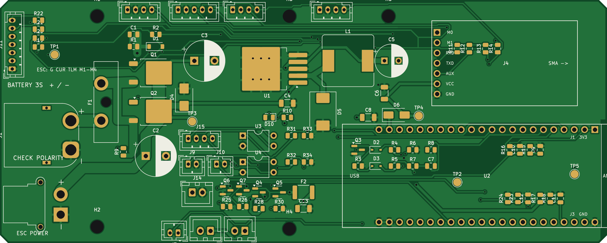
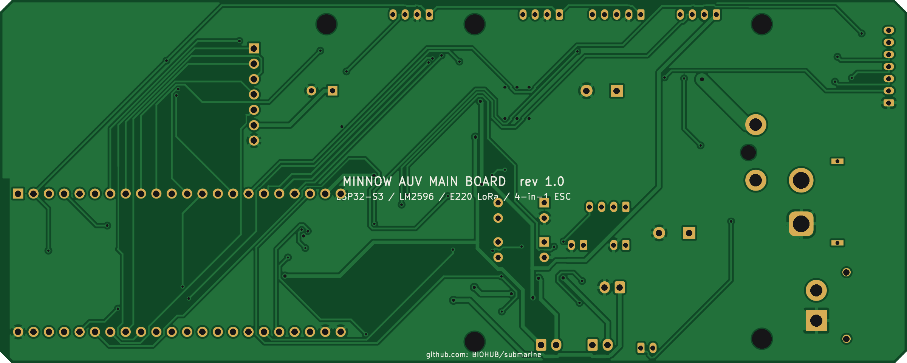

# PCB: the main board

A 150 x 60 mm, 2-layer carrier board for the ESP32-S3-DevKitC-1. It handles battery input, the 15 A fuse, the
magnet-operated soft-latch power switch, a 3 A 5 V regulator, the LoRa radio socket, all sensor connectors,
the 4-in-1 ESC interface, switched outputs, and camera power and button control.
How it works is explained in [`../docs/02-electronics.md`](../docs/02-electronics.md).

| Top | Bottom |
|---|---|
|  |  |

## Files

| File | What it is |
|---|---|
| `auv-mainboard.kicad_pro / .kicad_sch / .kicad_pcb` | The KiCad project (opens in KiCad 7 or newer) |
| `auv.kicad_sym`, `auv.pretty/` | Project library: ESP32-S3-DevKitC-1 socket and E220 socket symbols and footprints |
| `output/auv-mainboard-gerbers.zip` | **Upload this to JLCPCB / PCBWay.** Gerbers + drill files |
| `output/auv-mainboard-bom.csv` | Board parts list with suggested part numbers and rough prices |
| `output/auv-mainboard-pos.csv` | Pick-and-place file (if you want the board assembled) |
| `output/auv-mainboard-schematic.pdf / .png` | Schematic |
| `output/auv-mainboard-layout.pdf` | Top copper + silkscreen plot |
| `output/board_top.png`, `board_bottom.png` | Realistic images made from the Gerber layers |
| `design.py` | **Source of truth**: every part, pin, net, position and net class |
| `generate_board.py` | Turns `design.py` into everything above |
| `render_board_images.py` | Builds the board images from KiCad's layer plots |
| `placement.json` | Part positions and sizes for the Blender model |

## Status

* Schematic netlist (exported by KiCad) matches `design.py`: **0 mismatches**.
* Placement check: no courtyard overlaps. Only low SMD parts (≤ 3 mm) sit under the socketed DevKit and LoRa module.
* Routing: Freerouting 2.5, plus hand-placed wide copper for the battery -> fuse -> MOSFET -> ESC path
  (2.5–3 mm tracks, with the ground return on the bottom layer) and the regulator's switch node.
  Ground pours on both layers, and no copper under the ESP32 antenna.
* KiCad DRC: **0 errors, 0 unconnected pads**. The remaining warnings are silkscreen cosmetics and footprint-library
  links that need KiCad's global library table, which a normal KiCad install has.
* Fab limits used: 0.15 mm minimum track, 0.2 mm clearance, 0.35 mm minimum drill, 0.4 mm copper-to-edge.

## Regenerate

Needs KiCad 7+ (`pcbnew` Python module and `kicad-cli`), Java 25 and the Freerouting 2.5 jar. The board images need
Python with `cairosvg` and `Pillow`.

```bash
FREEROUTING_JAR=/path/to/freerouting-2.5.0-executable.jar python3 generate_board.py all
```

Steps, which can also be run one at a time: `libs sch verify_sch check route drc outputs`.
